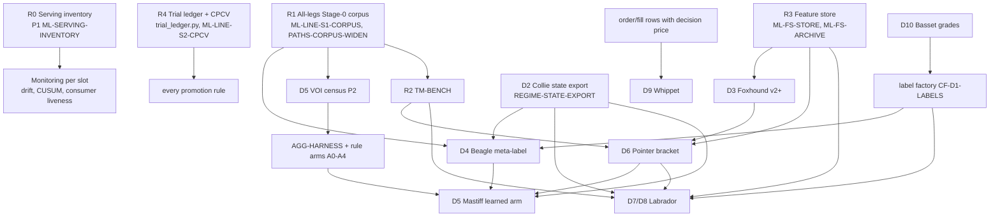

# ML roadmap, MECE: one model family per trade-lifecycle decision (2026-11)

> **Doc status:** `unknown` · category `plan` · last verified `2026-11-04` (registry read 18:19Z, trainer-vm-diag #22883; config read at `main@8287535f8`) · registered in [`docs/DOCUMENT-INDEX.md`](../DOCUMENT-INDEX.md)
> **Checklist row:** [`ML-ROADMAP-MECE`](../claude/work/checklist/ML-ROADMAP-MECE.json) (rank 1) · lane dispatched by Manager Session 2026-11-04a · Tier 1, planning only · track **MODEL**.
> **Feeds:** Thursday planning 2026-11-05 with the operator. **Parent / siblings (not replaced):** [`ML-PROGRAMME-2026-10-28.md`](ML-PROGRAMME-2026-10-28.md) (trade management, TM-BENCH), [`ml-live-promotion-plan-2026-10-29.md`](ml-live-promotion-plan-2026-10-29.md) (short path to live), [`COMPUTE-ALLOCATION-2026-11-03.md`](COMPUTE-ALLOCATION-2026-11-03.md) (capacity; § 6 here feeds it demand, it does not design capacity).

> ⚠️ **DRAFT: § 6 (infrastructure) and § 8/§ 10 (ranked proposals) are NOT final.** Manager instruction 2026-11-04 18:35Z,
> relaying the operator (~18:33Z): resource allocation and restructuring wait for the **DEEP-AUDIT-20261104** result
> (and ML-FRONTIER-PREP if it has landed). §§ 1–5, 7 and 9 (inventory, MECE map, per-slot specs, aggregator design,
> dependency graph, milestone diff, practice research) are the evidence draft. §§ 6, 8 and 10 are re-ranked after the audit lands.

## Gates this adds or changes

**None.** This document authorises nothing and queues nothing. Every row and unit in § 8 is a **proposal** for the
operator and the manager on Thursday. The `milestones.yaml` change in § 7 is **described, not applied** (roadmap edits
are agreed in Thursday planning). The `lifecycle_slot` field proposed in § 8 is report-only: no guard refuses
anything because of it. Promotion is unchanged: the ladder, a rule registered before the run, net of the full cost
stack, then the existing tiers.

---

## 0. The answer in ten lines

1. **The trade lifecycle has nine decisions** (§ 2). Each is owned by exactly one model family, or is marked
   **none yet** with a stated reason. The families are the breeds in [`model_names.yaml`](../reference/model_names.yaml).
   Two breed jobs are restated so the map has no overlap (§ 2.2): **Pointer** moves from "direction" (Foxhound already
   outputs LONG/SHORT/NOTHING) to **bracket at entry**; **Mastiff** moves from "conviction / sizing" to the operator's
   **position aggregator**. Both are display-name proposals for the operator.
2. **What changes orders today (MEASURED, § 1).** On **real-money and prop books**, three learned artifacts:
   **Foxhound-1** (entry on `bybit_2` + `bybit_portfolio`), **Labrador-1b** (TP revision on Foxhound-1's trades) and
   the **TD meta-label overlay** (`ml/overlay/overlay_td.json`, reduce ×0.5 on `trend_donchian_xrp_4h` and
   `trend_donchian_eth_prop`). On the **`bybit_1` demo floor only**, also: Foxhound-2, the 3 advisory **regime heads**
   (BTC `trend_vol` off-cells), the frozen m27 XRP vol spec, and the exit head (closes on `trend_donchian_eth`).
3. **The registry does not hold any model that changes a real-money order.** Its 98 rows are advisory 3 · shadow 20 ·
   candidate 74 · research_only 1, and all 3 advisory rows are vol-regime heads. Foxhound-1, Labrador-1b and the overlay
   are served artifacts outside it. In model-risk terms ([SR 11-7](https://www.federalreserve.gov/supervisionreg/srletters/sr1107.htm)),
   **the model inventory is incomplete**. Fixing that is the cheapest high-value item in this plan (§ 8, P1).
4. **Effort is not where the decisions are.** 72 of 98 registry rows are `market_features` (regime) heads. Three
   decisions have no model at any stage: **bracket at entry, position aggregation, post-trade review**. GBDT is 77 of
   98 registered models (`ml_plan_status.py --diversity`, run 2026-11-04).
5. **Each slot gets a question, a baseline to beat net of cost, a label, an offline harness and its data** (§ 3).
   Most harnesses already exist. The gap is the mapping. ~142 open ML-touching checklist rows carry no slot, which is
   how work turns into test-guessing.
6. **The position aggregator (Mastiff)** is specified in § 4: baselines (today's slices, 1/N, best-single, Carver-style
   forecast combination, random), a portfolio-level net-R-per-capital-day label, a multi-leg same-symbol replay harness,
   and **a value-of-information step first**. M18 measured that ranking packages on one symbol had **no edge** (the EV
   pick agreed with priority ~96–97%). Aggregating is a different question from ranking, but the prior is weak.
7. **There is a tension to settle on Thursday.** On 2026-11-01 the operator said *"No position sizing ... We already
   have a risk manager"* (row `ML-DECISION-MODELS`). On 2026-11-04 the operator proposed the aggregator. § 4.6
   scopes Mastiff so it never sets per-trade risk: it only splits the budget the RiskManager already set, and nets
   packages. Whether that scoping is what the operator meant is a **preference no data settles**, so it is the one
   operator question in this doc.
8. **The research dependency graph** (§ 5) has three roots that unblock almost everything: **serving inventory**,
   the **all-legs Stage-0 corpus**, and **TM-BENCH**. The **feature store** is a fourth root for the market-context models.
9. **Infra** (§ 6) is stated as **demand** for COMPUTE-ALLOCATION-DESIGN: which jobs, how often, roughly how heavy,
   on which backend. It contains no capacity design.
10. **Proposals** (§ 8): 12, ranked by value per cost, each with a proposed row or unit id. The top three cost about
    $20 of session budget plus free runner time, and they turn the map into a weekly report.

---

## 1. What runs today (MEASURED; population and source on every line)

### 1.1 The registry

| fact | value | population · source · time |
|---|---|---|
| registry rows | **98** = advisory 3 · shadow 20 · candidate 74 · research_only 1 | every row of `ml/registry-store/registry.jsonl` on the trainer, latest per `model_id`, field `target_deployment_stage` · trainer-vm-diag #22883 · 2026-11-04 18:19Z |
| ⚠️ legacy `status` field | `candidate` on **all 98** | same read (#22882). Known gap, row `ML-REGISTRY-LADDER-GAPS` (I4). `stage_history` is empty on 68 rows. |
| advisory (can influence an order) | `btc-regime-15m-lgbm-fc-pcv-v2` (Collie-5a), `sol-regime-15m-lgbm-fc-pcv-v2` (Collie-5b), `mes-regime-5m-lgbm-v2` (Chihuahua-1d) | same read |
| family mix | market_features 72 · setup_candidates 10 · conviction_meta 4 · trade_outcomes 4 · setup_labels 3 · market_sequences, corpus_panel, execution_quality, account_context, setup_labels_audit 1 each | same read, `manifest.dataset.family` |
| learner mix | gbdt 77 · rule_baseline 14 · bayesian 5 · deep_sequence 1 · ssl 1 | `python3 scripts/ops/ml_plan_status.py --diversity`, 2026-11-04 ~18:15Z, 98 registered models |
| trainer | `ict-trainer.service` inactive (between cycles), timer active; last cycle line `publish_post_ok` 09:18:39Z | #22882 |
| served artifacts (not registry rows) | `ml/served/{ml_decision_entry_v1, ml_decision_entry_v2, ml_entry_tp_revision_v1}` | `ls ml/served` on the trainer (#22882) and in the repo |

### 1.2 What changes an order (read from config, `main@8287535f8`)

| model (display name) | what it changes | books | stage / source of truth |
|---|---|---|---|
| `ml-decision-entry-v1` (**Foxhound-1**) | opens LONG/SHORT at every 4th closed 1h bar | `bybit_2`, `bybit_portfolio` (real money + mirror, 5 crypto), `alpaca_paper` (13 ETFs) | served artifact; `config/strategies.yaml::ml_entry` |
| `ml-decision-entry-v2` (**Foxhound-2**) | same, R2 recipe | `bybit_1` (demo floor) | served artifact; `ml_entry_v2` |
| `ml-entry-tp-revision-v1` (**Labrador-1b**) | moves Foxhound-1's TP, extend-only, at 4h check-ins | wherever `ml_entry` trades | served artifact; `ml_entry.tp_revision` |
| TD meta-label overlay (unnamed; job = **Beagle**) | multiplies qty ×0.5 when the score is below tau | `reduce` on `trend_donchian_xrp_4h` (`bybit_2`/`bybit_portfolio`) and `trend_donchian_eth_prop` (`bybit_1` + 3 prop accounts); `annotate` on `trend_donchian_eth_4h`, `trend_donchian_sol_prop` | `ml/overlay/overlay_td.json`; `config/overlay_policy.yaml` |
| `exit-head-donchian-1h-v1` (**Labrador** job, no name) | closes the position | `close` on `trend_donchian_eth` (`bybit_1`); `annotate` on `trend_donchian`, `trend_donchian_sol` | `strategies.yaml::exit_head_model/_action`; not in the advisory/shadow list of #22883 |
| advisory vol heads (Collie-5a/5b, Chihuahua-1d) | drop intents in `trend_vol` off-cells | BTC cells only: `trend_donchian`, `ict_scalp_5m`, `squeeze_breakout_4h` (`config/regime_policy.yaml::trend_vol`) | registry `advisory`. `REGIME_ML_VERDICT_MODE=use` was confirmed 2026-10-28 (get-env run 40775326133); **not re-verified today** |
| `m27-derived-xrpusdt-5m-frozen` | vol-bucket off-cells | `ict_scalp_xrp_5m` | `strategies.yaml` `vol_spec`; not a registry row |
| `claude_desk` (LLM, not ML) | proposes entries, manages | `bybit_1`, `ib_paper`, `alpaca_paper` | a **benchmark / teacher** (B3 in the ML programme), not a family in this map |

**Read of § 1 (INFERRED from the two tables):** the models that touch real money all sit **outside** the registry,
the gates and `stage-guard`. So the ladder's tooling (gate-check, promotion readiness, drift on `/api/bot/shadow/drift`)
watches the regime heads and misses the money models. Each money model does carry its own record and demotion
signal (`overlay_cusum.py`, `ML-ENTRY-LIVE-MONITOR`), but no single list answers *"which models change which
decisions on which books"*.

---

## 2. The MECE map: nine decisions, one family each

### 2.1 How the lifecycle is cut

Rules used to make the cut mutually exclusive and collectively exhaustive:

- **A decision is an action that changes an order, a position or a record.** A **state estimate** (regime, volatility,
  forecast) is an input, not a decision. It belongs to the decision it gates.
- **Time order.** Each decision happens at one point in the life of a trade. Two decisions at the same point are
  split by **what they change**: the side and existence of a trade, its size, or its brackets.
- **Per-trade risk size is not a model slot.** It belongs to `RiskManager` (operator, 2026-11-01). Account-level
  risk (the daily-DD switch, prop limits) is a **constraint** on every slot, not a slot.

| # | decision (when · what it changes) | owning family | live today | the slot's one question |
|---|---|---|---|---|
| **D1** | **Universe & book** (weekly+ · which symbols and legs are on which book) | **none yet**: the promotion ladder (Stage 0 offline → soak → live) decides | rule | — (kept as a rule; § 3 D1 says why) |
| **D2** | **Regime gate** (each bar · may this leg fire in the current market state?) | **Collie** (incl. the 5m heads named **Chihuahua**) | advisory 3, shadow ~17 | is this leg in a state where its trades lose net of cost? |
| **D3** | **Entry generation** (each decision bar · open long/short/nothing, tied to no strategy) | **Foxhound** | Foxhound-1 real money; -2 demo | does a market-context model's entry beat random entry and the strategies, net of cost? |
| **D4** | **Signal filter** (when a strategy fires · take, reduce or skip *that* signal) | **Beagle** (meta-label) | TD overlay (2 legs reduce) | does a meta-label beat take-all and a same-rate random skip? |
| **D5** | **Position aggregation** (when ≥2 packages want one (account, symbol) · how the budget is split and netted into one position) | **Mastiff** (restated: the aggregator) | none; rule = slices (`allocator_ev.py` + `slice_allocation.yaml`) | does a learned split/net beat today's slices, 1/N and best-single? |
| **D6** | **Bracket at entry** (at entry · where SL and TP sit) | **Pointer** (restated: points to the target) | none ML; fixed ATR rules + `structure_exit` | does a predicted bracket beat the leg's fixed bracket at the same entries? |
| **D7** | **In-trade management** (each check-in · hold, move SL, move TP, partial) | **Labrador** | Labrador-1b (TP extend-only, `ml_entry`) | does a policy beat the leg's own rules, the best static rule and a matched random intervention? |
| **D8** | **Exit now** (each check-in · close the whole position) | **Labrador** (same family; separate head) | exit head closes 1 demo leg | does closing now beat holding to the bracket, net of cost? |
| **D9** | **Execution** (at order · maker/taker, limit offset, timing) | **Whippet** | baseline only (Mutt-Execution-1a, shadow) | does a fill policy cut realised cost vs today's order type? |
| **D10** | **Review & grading** (after close · grade the decision; feed labels back) | **Basset** | none ML; Claude grades (CJ) and `forecast-grade` are tools, not models | does a grade predict the next N trades' decay of a leg better than a CUSUM on R? |

(D10 is listed tenth for clarity; the operator's eight decisions are D1–D8 and D10. Execution is added because
without it the map has a gap: realised cost is a decision the system makes on every order.)

**Check that it is MECE (verified by construction, and against the 9 served/consumed models in § 1.2):** every
model in § 1.2 maps to exactly one row: Foxhound-1/-2 → D3; overlay → D4; Labrador-1b → D7; exit head → D8; vol heads
and m27 → D2; Mutt-Execution → D9. No row has two families. **Mutts are not a family**: they are each slot's baseline
(Mutt-Regime → D2, Mutt-Execution → D9). **Canaan** (prop survival) is a constraint on D3–D5 under the prop superset
gate, not a decision. **Desk** decisions span D3/D7/D8 as a benchmark and a label source; they do not own a slot.

### 2.2 Naming changes this needs (display aliases only; the operator decides)

| breed | today's job in `model_names.yaml` | proposed | why |
|---|---|---|---|
| Pointer | Direction | **Bracket at entry (D6)** | Foxhound outputs LONG/SHORT/NOTHING, so a separate direction model would overlap D3. A pointer *points at the target*, which fits a TP/SL predictor. |
| Mastiff | Conviction / sizing | **Position aggregator (D5)** | Per-trade sizing is RiskManager's (operator 2026-11-01). The aggregator splits and nets a budget that is already set. |
| Chihuahua | Short-horizon alarm | **5m regime heads (sub-brand of D2)**; "early warning" becomes an *event trigger input* to D7's check-in policy | No anomaly detector exists (the yaml says so). The live Chihuahuas are 5m regime heads, so they belong to D2. |

---

## 3. Per slot: question, baseline, label, harness, data

"Baseline" is what the slot's model must beat **net of the full cost stack** (fees + slippage + funding;
`src/runtime/execution_costs.py`), out of sample, on the same decision points, under a rule registered before the
run. Every slot also beats a **matched random** control (practice principle M6). Harness names are files that exist
on `main` unless marked **(build)**.

### D1 Universe & book: none yet, on purpose

- **Why no model:** the decision is already made offline by the ladder (Stage 0 evidence → Gate 1 → soak → Gate 2), and
  edge is decided offline. A model that ranks legs from live P&L is the category error the operating plan forbids. With
  ~51 rostered legs, cross-sectional n is too small for a learned leg-selector.
- **Re-entry test:** reopen when ≥ 30 legs have committed Stage-0 records on one cost basis, so that "which legs to
  add" can be backtested as a selection over that panel (the `ML-LINE-S1-CORPUS` producer gives the panel).

### D2 Regime gate: Collie

| | |
|---|---|
| question | in which (trend × vol) cells does a leg lose net of cost, and does the ML vol label pick those cells better than a rule label? |
| baseline | the leg ungated; the HAR-RV / ATR-percentile rule label in the same cells (Mutt-Regime); the frozen-label cells (the A/B in `regime_policy.yaml` shows the ML label lifts the book and a frozen label loses) |
| label | **for the gate**: the leg's net R per trade inside the cell (regime-selectivity skill). **For the head**: the forward realised-vol bucket (already the head's target). Head accuracy is not the gate's metric. |
| harness | `scripts/research/regime_cell_walkforward.py`; `drift_regime_mix.py` for drift splits |
| data | `market_features` shards (BTC/ETH/SOL/MES today); missing XRP/ADA/AVAX at 15m/1h (`ML-COV-DATA-ALTS`) |
| state | the most mature slot. Gaps: cells exist **only for BTC legs on `bybit_1`**; 0 real-money legs gated; the 16-of-17 pooled trend-axis FAIL (`L-REGIME`) |

### D3 Entry generation: Foxhound

| | |
|---|---|
| question | does one pooled market-context model, tied to no strategy, choose LONG/SHORT/NOTHING with net R per decision ≥ 0? (operator bar 2026-11-01: *"prove that it won't lose money"*, point estimate ≥ 0, one model one read) |
| baseline | random entry at the same bars with the same bracket; always-nothing (0); the best single strategy on the same symbols |
| label | first-passage outcome of the reference bracket from the decision bar, net of cost (`ml/served/ml_decision_entry_v1`) |
| harness | the ENTRY pipeline + `ML-LEVER-HARNESS`; one-read log (`ML-BAR-ONE-READ`) |
| data | 60-perp Binance archive (`ML-FS-ARCHIVE*`); feature store (`ML-FS-STORE`, queued) |
| state | live. v1's own picks lose to random on the Oct-2026 forward window (`ML-ENTRY-FINETUNE`); v2 failed its W1 read (−0.1161 R, n=320). The question is recipe and target (`ML-RECIPE`, `ML-FS-LABELS`), not more serving |

### D4 Signal filter: Beagle

| | |
|---|---|
| question | for a strategy's own signal, does a meta-label take/reduce beat take-all and a same-rate random reduce, at non-inferior drawdown? |
| baseline | take-all; same-rate random skip/reduce (the overlay's evidence beat it at p<0.001); the cost-aware EV score in `allocator_ev.py` |
| label | the strategy's own trade net R from that signal, triple-barrier at its bracket (AFML ch. 3 meta-labelling) |
| harness | `RULE-ML-OVERLAY-NONINFERIOR-V2` units (`RQ-20261029-5785-02`); `src/research/meta_label.py`; `setup_candidates` family builds |
| data | per-leg Stage-0 `--emit-trades` with decision-time features (`METALABEL-EMIT-FEATURES`, `ML-LINE-S1-CORPUS`) |
| state | overlay live on TD family; PB2H failed; 10 `setup_candidates` heads stuck at candidate on a gross-cost eval (`ML-P1-COSTNET-REBUILD`) |

### D5 Position aggregation: Mastiff (§ 4 has the full design)

### D6 Bracket at entry: Pointer

| | |
|---|---|
| question | at the same entries, does a predicted SL/TP (first-passage distribution over an ATR grid) beat the leg's fixed bracket? |
| baseline | the leg's own bracket; a static per-leg best bracket chosen without the test folds (exit-refinement P1); the TP-doctrine measured-move rule |
| label | for each candidate (SL, TP) on the grid, the net R realised on the real path from that entry (counterfactual replay prices every geometry exactly) |
| harness | TM-BENCH (`scripts/research/tm_bench.py`) entry-state mode; `exit_lever_ablation.py` |
| data | paths corpus (`PATHS-CORPUS-WIDEN`); features shared with D7 (`ML-FS-BRACKETS-HOLD`) |
| state | **none at any stage.** Labrador-1b already predicts the TP grid *in-trade*; the same model scored at bar 0 is the cheapest first Pointer (proposal P6) |

### D7 In-trade management and D8 Exit now: Labrador

These are owned by [`ML-PROGRAMME-2026-10-28.md`](ML-PROGRAMME-2026-10-28.md) § 1–4 and are **not restated**: the policy
target, baselines B0–B6, the check-in-policy factor (cadence × triggers), S-OFFLINE, and TM-BENCH. This plan adds
only the split: **D7 = actions that keep the position open** (move SL, move TP, partial); **D8 = close all**. They
are separate heads because their evidence differs: the one-step exit-now policy FAILED on money (`d6e7-06`), the
ML-gated 50% partial FAILED (`RQ-20261029-a7e1-01`), the BTC exit head fails B4 (−0.0141 R/trade, n_oos 1,041), while
Labrador-1b (TP extend) passed its forward read (+0.0081 R/trade, n=868).

### D9 Execution: Whippet

| | |
|---|---|
| question | does a maker-first / offset policy cut realised entry+exit cost vs today's order type, without losing more than it saves in missed fills? |
| baseline | today's order type per venue; Mutt-Execution-1a |
| label | realised slippage vs decision price, in bps and in R, per order; a missed fill priced at the trade's counterfactual R |
| harness | **(build)** fill-replay on `trade_journal.db` order rows; desk maker-fill lever `RQ-20261030-f18f-01` is the first data |
| data | order/fill rows with decision price (`execution_quality` family: 1 registry row) |
| state | low n on real money; value bounded by cost stack (fee 11 + slippage 3 bps round trip in the overlay's evidence). Rank it after D5's census |

### D10 Review & grading: Basset

| | |
|---|---|
| question | does a per-decision grade (Claude blind grade, first-passage forecast grade) predict a leg's or model's next-N decay earlier than a CUSUM on realised R? |
| baseline | `overlay_cusum.py`-style Bernoulli CUSUM; the S6 CUSUM-retrain line |
| label | the leg's next-N-trade net R vs its Stage-0 band |
| harness | **(build)** small join of `comms/claude_judgments/`, `forecast-grade` output and journal outcomes |
| data | CJ stores (617 blind / 546 revealed grades, M25 where-text) |
| state | none. Its main value is upstream: it is the **label factory** (`CF-D1-LABELS`, `DESK-11-ML-FEED`) for D4/D7/D8 |

---

## 4. The position aggregator (Mastiff, D5)

### 4.1 What exists

- `config/slice_allocation.yaml` (Tier 3): on `position_model: slices` accounts each strategy gets a share of a
  per-(account, symbol) budget of `symbol_budget_trades: 1.0` trades of risk, weighted by a 6-input conviction blend
  (`c_strat .35, c_setup .10, c_wr .10, c_reg .10, c_bt .20, c_live .15`). Open slices of other legs count at their
  current stop. `declared_slices` give the desk and E4 their own 0.5.
- `src/runtime/allocator_ev.py::intent_allocation_score` computes the weight and the cost-aware EV_R beside it.
- **The motivating failure** (`PI-20261104-BCZDXJNR-0002`): `ict_scalp_sol_5m` long refused `slice_budget_exhausted`
  on `bybit_1` because `trend_donchian_sol_4h`'s open short held the SOL budget.
- **The prior** ([`M18-allocator-backtest-findings-2026-06-29.md`](../research/M18-allocator-backtest-findings-2026-06-29.md)):
  on one symbol, EV ranking and priority routing agree ~96–97% of the time; the disagreements are noise. That tested
  **choosing one** package. It did not test **weighting and netting several**, which is what the aggregator does.

### 4.2 The question (pre-registration draft)

*On (account, symbol) pairs where ≥ 2 packages are live at once, does one netted position whose size is a learned
weighting of the packages earn more net R per capital-day than today's slices, at a max drawdown no worse, out of
sample, net of the full cost stack?*

### 4.3 Baselines (all net of cost, same tick stream)

| id | baseline | why |
|---|---|---|
| A0 | **today's slices** (`slice_allocation.yaml` as committed, refusals included) | the incumbent |
| A1 | **1/N netting**: equal weight on every live package, netted | equal weights are hard to beat out of sample (DeMiguel, Garlappi & Uppal 2009; Timmermann 2006) |
| A2 | **best-single**: the highest-EV package takes the whole budget (the old pick-one election) | the M18 result says this ≈ priority |
| A3 | **forecast combination rule**: each package → a signed scaled forecast (direction × conviction, capped), weighted, × a diversification multiplier, then netted (Carver, *Systematic Trading*, ch. 8 + App. D) | the practitioner rule the learned version must beat |
| A4 | **matched random weights** at the same ticks | catches a "win" that comes from trading more or less |

### 4.4 Label and the unified bracket

- **Label:** per (account, symbol) **episode** (from the first package opening to the last package closing), the
  net R of the unified position per capital-day, R measured against the account's one-trade risk.
- **Unified bracket, three arms to test, not to decide here:** (U1) keep each slice's own bracket inside a netted
  venue position (today's design; virtual slices); (U2) one bracket = the risk-weighted average stop and target of the
  packages; (U3) one bracket = the tightest stop and the nearest target (conservative). U1 is the operator's 2026-10-15
  design (*"each piece of that position has its own brackets"*) and is the default.
- **Venue physics is a constraint, not a lever:** on a one-way book opposite packages net to a smaller position;
  on a hedge book they can coexist. Netting saves the cost of trading both sides (Almgren & Chriss 2000; trade only
  the net).

### 4.5 Harness and data

- **Harness (build, row `AGG-HARNESS`):** a same-symbol multi-leg replay that runs every rostered leg's Stage-0
  `--emit-trades` stream for one symbol on one clock and applies A0–A4 plus the learned arm. Starting points that
  exist: `scripts/research/allocator_multisymbol_backtest.py` (cross-symbol, shared budget),
  `same_symbol_head_to_head.py`, `allocator_candidate_dataset.py` / `allocator_ranker_eval.py`.
- **Data:** per-leg Stage-0 emits with decision-time scores for every leg on the symbol (`ML-LINE-S1-CORPUS`); live
  refusal counts by reason (the census below).
- **Learned arm only after the rule arms are graded.** Stack on out-of-fold package scores only, purged and grouped by
  episode (Wolpert 1992; AFML ch. 7). A learned arm that cannot beat A3 closes the line.

### 4.6 Scope against the operator's sizing rule (the one operator question)

Mastiff **never raises the risk on a symbol above `symbol_budget_trades` × the RiskManager's one-trade risk** and never
sets per-trade risk. It decides **how the budget already set is split and netted**. That is allocation, not sizing.
Every change to `slice_allocation.yaml` numbers stays Tier 3. **Thursday question:** *is a model that splits and nets
the existing per-symbol budget inside the 2026-11-01 "no position sizing" rule, or outside it?* No data settles this;
it is the operator's definition.

### 4.7 Value of information first (proposal P2)

Before any harness: count, over the last 14 days on every slices account, intents refused per reason
(`slice_budget_exhausted`, `opposite_slice_one_way_book`, ...) and how many were on real money; and count, in the
Stage-0 emits, how often ≥ 2 legs hold one symbol at once. **If concurrent episodes are rare, the aggregator's ceiling
is small** and the fix is the budget policy (`PI-20261104-BCZDXJNR-0002` item 2), not a model. This folds that
pipeline item's TODO (1).

---

## 5. Research dependency graph



**Reading the graph (DECIDED, from the edges):**

1. **Roots, in order of fan-out:** R1 corpus (feeds 4 slots), R3 feature store (3), R2 TM-BENCH (2 + D5 via D6),
   R0 inventory (all monitoring). R4 trial ledger feeds every promotion rule and already exists as report-only.
2. **D5 is a leaf.** It needs the corpus, D4 scores, D2 state and D6 brackets. That is why its first step is a cheap
   census and its learned arm is last.
3. **D9 and D10 are independent of the rest.** They can run any week capacity is free; neither blocks a money slot.
4. **D3 does not wait for TM-BENCH.** Its gap is recipe and target (`ML-RECIPE`, `ML-FS-LABELS`), which the feature
   store unblocks.

---

## 6. Infrastructure: demand for COMPUTE-ALLOCATION-DESIGN (DRAFT, pending DEEP-AUDIT-20261104)

This section states **what the roadmap needs to run**. It does not size machines or route jobs; that is
`COMPUTE-ALLOCATION-DESIGN` (row blocked; design `COMPUTE-ALLOCATION-2026-11-03.md`). Heaviness figures are ESTIMATED
from the named measurements.

| layer | job | cadence | weight (ESTIMATED) | fits on |
|---|---|---|---|---|
| training | regime heads (D2) nightly cycle | daily | 5m heads peak RSS ~4.7 GB vs 4.5 GiB MemoryMax (MEASURED 2026-10-18, ROADMAP ML § update) | trainer VM; 5m heads are the memory risk |
| training | Foxhound/Pointer/Labrador pooled models (D3/D6/D7) on the 60-perp archive | weekly (`ML-ENTRY-RETRAIN-CADENCE`) + per lever unit | CPU GBDT, minutes to ~1 h per fit | Kaggle CPU / runner (`ML-DATA-OFF-TRAINER` publishes shards off the trainer) |
| training | frontier families (TSFM, TabICL/TabPFN, GRU) | per bake-off unit | GPU-optional | Kaggle GPU (`COMPUTE-GPU-WIRE`) |
| evaluation | TM-BENCH runs (D6–D8) | per unit | replay-bound, CPU | research runner |
| evaluation | same-symbol multi-leg replay (D5) | per unit, after P2 | replay-bound, CPU, small | research runner |
| evaluation | trial ledger + CPCV | weekly | light | runner (exists, weekly) |
| serving | registry advisory path (D2) and served-artifact path (D3/D7/D4) | every tick | already live | live VM; two serving paths, one inventory needed (P1) |
| monitoring | per-slot demotion signal: CUSUM (D4 exists), live-vs-band (D3 queued), drift split (D2 exists) | daily | light | runner / VM read routes |
| data | feature store as-of join with `available_at` (Feast-style point-in-time) | build once, then daily | storage-bound | trainer disk / runner cache |

**The one infra gap this map adds (P1):** one serving inventory over both serving paths, keyed by slot. Everything
else in the table already has a row.

---

## 7. Proposed `docs/roadmap/milestones.yaml` change (described, NOT applied)

Agreed in Thursday planning or not at all. Two new milestones under goal **G4**; no existing entry reworded.

```yaml
  - id: L-ML-MECE
    goal: G4
    name: Every trade-lifecycle decision has one owning model family with a registered question, baseline, label and harness
    status: proposed
    where: >-
      2026-11-04 (lane ML-ROADMAP-MECE): docs/plans/ML-ROADMAP-MECE-2026-11.md maps 10 decisions (D1-D10) to one family each;
      3 have no model at any stage (D5 aggregation, D6 bracket at entry, D10 review); the registry holds none of the 3 models
      that change real-money orders (trainer-vm-diag #22883).
    next: >-
      Done when (a) one serving inventory lists every order-changing model with its slot and books (P1), and (b) the
      weekly /ml-review prints a slot report where every open ML row/unit names a slot and every slot names its next unit (P3).
    owner: manager
    reviewed: 2026-11-04
  - id: L-ML-AGGREGATOR
    goal: G4
    name: Position aggregator (Mastiff) -- research before build
    status: proposed
    where: >-
      Operator candidate 2026-11-04 ~10:15Z; baseline slices (src/runtime/allocator_ev.py + config/slice_allocation.yaml);
      M18 prior: single-symbol EV ranking ~= priority (96-97% agreement).
    next: >-
      VOI census first (P2); harness and rule arms A0-A4 only if concurrent episodes are material; learned arm last.
      Tier 3 when it changes allocation. Scope question to the operator (doc § 4.6).
    owner: manager
    reviewed: 2026-11-04
```

Also proposed: `M18` (portfolio allocator) gets a `where` line pointing at `L-ML-AGGREGATOR`, because the aggregator is
the next M18 question. Not applied; another lane's entry is not reworded here.

---

## 8. Proposals, ranked by value per cost (DRAFT ranking, pending DEEP-AUDIT-20261104; propose only; nothing is queued)

Cost = session ceiling (USD) + runner time. Value = what decision it unblocks. Each names the **proposed** id; the
manager assigns final ids on filing. Units follow the queue's `RQ-<date>-<hex>-NN` form; `mece` is a placeholder.

| rank | proposal | slot | what | value | cost | proposed id |
|---|---|---|---|---|---|---|
| **1** | **Serving inventory** | all | `scripts/ops/ml_inventory.py`: join the registry, `ml/served/*`, `ml/overlay/*`, `strategies.yaml` / `overlay_policy.yaml` / `regime_policy.yaml` consumers → one table: model, display name, slot, stage, books it changes, demotion signal, last scored. Report-only; on `/ml-review` step 1 | closes the SR 11-7 inventory gap; every later monitor keys on it | Sonnet $6 | row **ML-SERVING-INVENTORY** |
| **2** | **Aggregator VOI census** | D5 | 14-day refusal counts by reason per slices account (real vs demo) + Stage-0 count of concurrent same-symbol episodes per symbol | decides whether D5 is worth any build; folds `PI-20261104-BCZDXJNR-0002` TODO 1 | runner + Sonnet $4 | unit **RQ-20261105-mece-01** |
| **3** | **Slot report** | all | `lifecycle_slot` field (D1–D10) in `model_names.yaml` and `docs/plans/ml-plan-items.yaml`; `ml_plan_status.py --slots` prints, per slot, open rows/units, next unit, and flags unslotted ML rows. Report-only, never a gate | turns this map into the weekly driver; ends "random test-guessing" | Sonnet $8 | row **ML-SLOT-REPORT** |
| 4 | **Pointer v0 from Labrador-1b** | D6 | score the served TP-revision model at bar 0 of Foxhound-1 entries vs the fixed 3-ATR TP, on the frozen held-out window, one read | first D6 evidence at near-zero build cost (model exists) | runner + Sonnet $5 | unit **RQ-20261105-mece-02** |
| 5 | **Aggregator rule arms** | D5 | `AGG-HARNESS` same-symbol multi-leg replay + A0–A4, pre-registered; **only if P2 shows material concurrency** | answers "is a rule split better than slices" before any ML | Sonnet $12 | row **AGG-HARNESS** + unit **RQ-20261105-mece-03** |
| 6 | **Regime gate on a real-money leg** | D2 | `regime_cell_walkforward` for the real-money roster legs (XRP/ETH TD, pullbacks) on the advisory vol label where it exists, rule label elsewhere | first D2 evidence off the BTC demo legs | runner | unit **RQ-20261105-mece-04** |
| 7 | **Breed restatement** | naming | `model_names.yaml`: Pointer → D6, Mastiff → D5, Chihuahua → 5m D2 sub-brand (§ 2.2) | names match jobs; MECE visible on the UI | Haiku $1 | rides on **ML-SLOT-REPORT** (operator OK first) |
| 8 | **Aggregator learned arm** | D5 | stacked out-of-fold package scores vs the best of A0–A4, purged by episode | the operator's candidate, properly tested | runner + Sonnet $8 | unit **RQ-20261105-mece-05** (blocked on 5) |
| 9 | **Whippet fill replay** | D9 | maker-first vs today's order type on journal fills; missed fills priced | caps realised cost; small on current n | Sonnet $8 | row **WHIPPET-FILL-REPLAY** |
| 10 | **Basset vs CUSUM** | D10 | does a grade predict next-N decay earlier than a CUSUM on R | earlier demotion signal; label factory | runner + Sonnet $6 | unit **RQ-20261105-mece-06** |
| 11 | **Promotion rule adds DSR/PBO** | all | each new slot unit's rule states the trial count from `trial_ledger.py` and a deflated-Sharpe / PBO line | multiplicity control per question (Bailey et al. 2017) | in each unit's text, $0 | no row: a drafting standard for units 01–06 |
| 12 | **D1 stays a rule** | D1 | record "none yet" with the re-entry test (§ 3 D1) | stops a leg-selector being built on n≈51 | $0 | no row: lives in this doc and `L-ML-MECE` |

**Existing rows this map absorbs rather than duplicates** (not new work; they get a slot): D2 `REGIME-PROGRAM`,
`ML-REGIME-15M-DRIFT`, `ML-HEAD-AGREEMENT-JOIN`; D3 `ML-DECISION-MODELS`, `ML-RECIPE`, `ML-FS-ENTRY-V2`,
`ML-ENTRY-FINETUNE`, `ML-TIMEFRAME`; D4 `ML-REAL-MONEY-OVERLAY`, `ML-P1-COSTNET-REBUILD`, `ML-P1-REGATE-POOLED-HEADS`;
D5 `NETTED-SLICES`, `SAME-SYMBOL-ALLOCATION`; D6 `ML-FS-BRACKETS-HOLD`, `BRACKETS-AS-PREDICTIONS`; D7/D8 `TM-BENCH`,
`ML-AM-NEXT-LIVE`, `ML-HOLDBIAS-EXIT-MODEL`, `ML-ENTRY-TP-REVISION`, `IN-TRADE-EXIT-MODEL`; D9 desk maker fills; D10
`CJ-4-LABEL-VALIDATION`, `CF-D1-LABELS`; roots `ML-LINE-S1-CORPUS`, `ML-FS-STORE`, `ML-LINE-S2-CPCV`.

---

## 9. How investment-grade operations run the ML iterative workflow (deep research)

Tags: **ACAD** peer-reviewed or academic book · **PRAC** practitioner · **VEND** vendor, platform or regulator.
**Verification state is stated per line.** "Searched" = located this session by web search (title, venue and URL
confirmed at listing level, full text not read). "Repo" = already cited with a read in
[`practice-review-trade-mgmt-and-ai-2026-10-28.md`](../research/practice-review-trade-mgmt-and-ai-2026-10-28.md)
(its `[S#]` tag). "Memory" = from prior knowledge, not re-read; do not quote numbers from these.

### 9.1 What the practice says, and what it means for this map

| # | practice | source (tag · verification) | implication here |
|---|---|---|---|
| 1 | **Decompose the decision into slots, each with its own model and test**: primary signal → meta-label (take/skip, precision) → sizing → combination → execution | López de Prado, *Advances in Financial ML* (2018) ch. 3 (ACAD book · Repo [S19]); Isichenko, *Quantitative Portfolio Management* (2021) (PRAC book · Memory); Kissell, *Science of Algorithmic Trading* (2013) (PRAC book · Memory) | the D1–D10 cut; D4 and D9 as separate slots |
| 2 | **Production ML at large firms sits where feedback is dense and the cost metric is clear**: execution, routing, hedging | Man AHL execution router [S31] (PRAC · Repo); JPM deep hedging [S35] (ACAD · Repo) | D9 is a natural ML slot; D1 is not |
| 3 | **Model inventory, independent validation, effective challenge, ongoing monitoring** | Fed/OCC **SR 11-7** (2011), https://www.federalreserve.gov/supervisionreg/srletters/sr1107.htm (VEND/regulator · Searched; ⚠️ search results report it was superseded by **SR 26-2**, 2026-04-17, not read) | P1 serving inventory; per-slot demotion signal |
| 4 | **Count every trial; deflate selection** (deflated Sharpe, PBO via CSCV) | Bailey, Borwein, López de Prado & Zhu, "The Probability of Backtest Overfitting", *J. Computational Finance* (DOI 10.21314/jcf.2016.322), https://www.risk.net/journal-of-computational-finance/2471206/the-probability-of-backtest-overfitting (ACAD · Searched); deflated Sharpe [S45–S48] (ACAD · Repo) | proposal 11; `trial_ledger.py` already counts |
| 5 | **Purged, embargoed, trade-grouped CV**; store each label's end time | AFML ch. 7 [S50] (ACAD · Repo via secondary) | every slot's harness; `ML-LINE-S2-CPCV` |
| 6 | **Higher hurdle for new effects** (t > 3) | Harvey, Liu & Zhu (2016) *RFS* 29(1) (ACAD · Memory) | slot rules for genuinely new families |
| 7 | **Backtest Sharpe barely predicts live Sharpe**; the gap grows with backtests run | Wiecki et al. (2016) [S42] (ACAD · Repo) | one model, one read (`ML-BAR-ONE-READ`) |
| 8 | **Plan for decay** | McLean & Pontiff (2016) *JF* [S43] (ACAD · Repo) | per-slot CUSUM, not a one-off pass |
| 9 | **Equal weights are hard to beat out of sample** | DeMiguel, Garlappi & Uppal (2009) *RFS* 22(5):1915–1953 (ACAD · Searched); Bates & Granger (1969); Timmermann (2006) (ACAD · Memory) | aggregator baseline A1 |
| 10 | **Combine forecasts by scaling, capping, weighting and a diversification multiplier**, not by voting | Carver, *Systematic Trading* (2015) ch. 8, App. D (PRAC book · Searched, secondary summaries only); Grinold & Kahn (2000) (ACAD book · Memory) | aggregator baseline A3 |
| 11 | **Stack only on out-of-fold predictions** | Wolpert (1992) *Neural Networks* 5(2) (ACAD · Memory) | the learned aggregator arm |
| 12 | **Trade only the net** | Almgren & Chriss (2000) *J. Risk* (ACAD · Memory) | the netting arm of D5 |
| 13 | **Launch a heuristic first; log features at serve time to catch training–serving skew** | Zinkevich, "Rules of Machine Learning" (Google), https://developers.google.com/machine-learning/guides/rules-of-ml (VEND/PRAC · fetched by the research subagent, content not re-read) | rule arms before learned arms (D5); serve parity (`ML-FS-SERVE-PARITY`) |
| 14 | **Undeclared consumers and entanglement are ML technical debt** | Sculley et al. (2015) NeurIPS, https://papers.nips.cc/paper/2015/hash/86df7dcfd896fcaf2674f757a2463eba-Abstract.html (ACAD · page fetched by subagent, not re-read) | the aggregator consumes D2/D4 outputs; inventory must list consumers |
| 15 | **Separate input drift from labelled decay** | Gama et al. (2014) *ACM Comput. Surv.* 46(4) (ACAD · Memory) | `drift_regime_mix.py` split; per-slot monitor |
| 16 | **Research as an assembly line, not lone builders**; idea → protocol → fixed thresholds → committee → small capital → scale | López de Prado, "10 Reasons Most ML Funds Fail" (2018) [S18] (PRAC · Repo); Man AlphaGPT gates [S32] (PRAC · Repo); Arnott/Harvey/Markowitz protocol [S20] (ACAD · Repo) | one question per slot, one owner, one harness |
| 17 | **Prefer a supervised meta-model over the best rule; RL only as fine-tuning** | [S38], [S39] (ACAD · Repo) | D7/D8 design (owned by the ML programme) |
| 18 | **Rank experiments by expected decision value over cost**; skip a test that cannot change a decision | Howard (1966), "Information Value Theory", *IEEE Trans. SSC* (ACAD · Memory) | § 8 ordering; P2 before any D5 build |

### 9.2 Where we already match, and where we do not

**Match (INFERRED from the repo):** pre-registered rules, net of a full cost stack, a matched random control, purged
folds, one-read held-out discipline, a trial ledger, CUSUM demotion on the overlay, a registry with stages.

**Gaps:**
- **Inventory** (row 3): the registry and the order path disagree about which models exist. That is P1.
- **Slots** (row 1): work is filed by row, not by decision, so two rows can attack one decision and a decision can
  have none. That is P3.
- **Effort placement** (row 2): 72 of 98 rows are regime heads, while D5, D6 and D10 have nothing. § 8 puts the next
  cheap evidence in D6 (P4) and D5 (P2).
- **Firm specifics**: no verified public workflow document from Two Sigma, Citadel, Jane Street, G-Research or Hudson
  River Trading was found (one search pass by the subagent). Nothing here rests on them.

---

## 10. Proposal → proposed row/unit id (DRAFT, pending DEEP-AUDIT-20261104)

| proposal (§ 8 rank) | proposed id | kind | tier | roadmap |
|---|---|---|---|---|
| 1 Serving inventory | `ML-SERVING-INVENTORY` | checklist row | 1 | L-ML-MECE, M25 |
| 2 Aggregator VOI census | `RQ-20261105-mece-01` | queue unit | 1 | L-ML-AGGREGATOR, M18 |
| 3 Slot report + `lifecycle_slot` field | `ML-SLOT-REPORT` | checklist row | 1 | L-ML-MECE |
| 4 Pointer v0 from Labrador-1b | `RQ-20261105-mece-02` | queue unit | 1 (Tier 3 to apply) | L-ML-MECE, L-ML-LIVE |
| 5 Aggregator harness + rule arms | `AGG-HARNESS` + `RQ-20261105-mece-03` | row + unit | 1 (Tier 3 to apply) | L-ML-AGGREGATOR |
| 6 Regime gate on real-money legs | `RQ-20261105-mece-04` | queue unit | 1 (Tier 3 to apply) | L-REGIME |
| 7 Breed restatement | rides on `ML-SLOT-REPORT` | — | 1 (operator naming OK) | L-ML-MECE |
| 8 Aggregator learned arm | `RQ-20261105-mece-05` | queue unit (blocked on 5) | 1 (Tier 3 to apply) | L-ML-AGGREGATOR |
| 9 Whippet fill replay | `WHIPPET-FILL-REPLAY` | checklist row | 1 | L-ML-MECE |
| 10 Basset vs CUSUM | `RQ-20261105-mece-06` | queue unit | 1 | L-ML-MECE |
| 11 DSR/PBO line in slot rules | — | drafting standard | — | — |
| 12 D1 stays a rule | — | recorded here | — | L-ML-MECE |

**Thursday decisions for the operator:** (a) the § 4.6 scope question (is splitting and netting the existing
per-symbol budget inside the "no position sizing" rule?); (b) adopt the § 7 milestones; (c) the § 2.2 breed
restatement. Everything else is Tier 1 and can be filed by the manager once the map is agreed.

## 11. What this lane did and did not verify

- **Verified this session:** registry counts and families (#22882, #22883); served artifacts; the order-changing
  consumers in `strategies.yaml`, `overlay_policy.yaml`, `regime_policy.yaml`, `accounts.yaml` at `main@8287535f8`;
  `ml_plan_status.py --diversity`; the M18 96–97% figure (read from the findings doc); four citations by web search.
- **Not verified:** that the VM currently runs `REGIME_ML_VERDICT_MODE=use` (last read 2026-10-28); whether the exit
  head has a *candidate* registry row (my read listed only non-candidate rows); any live score or fill since
  2026-11-01; the "~142 open ML-touching rows" count is a keyword match on row ids over `docs/claude/work/checklist/`
  (states other than done/killed/archived) and over-counts desk rows; full texts of all § 9 sources.
- **Not done, by design:** no unit queued, no row filed, no milestone applied, no config touched.
- **ML-FRONTIER-PREP** had not landed output on `main` by 18:22Z; nothing from it is folded in.
