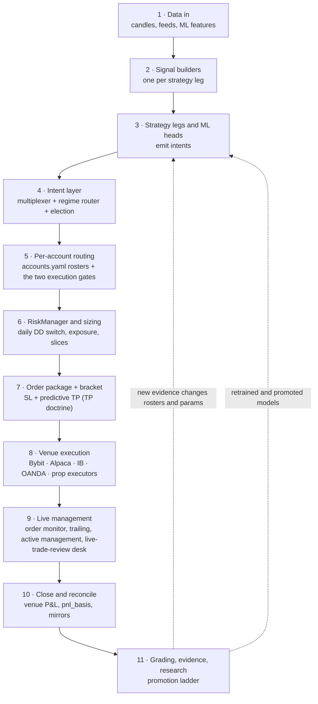

# Trading pipeline map — every step, technical and trading, side by side

> **Doc status:** `live` · category `lookup` · last verified `2026-11-14` · registered in [`docs/DOCUMENT-INDEX.md`](../../docs/DOCUMENT-INDEX.md)

**Gates this adds or changes:** none. This is a map, not a rule; it adds no CI guard, gate or required check.

**What this is.** One page that walks the live trading pipeline from market data to the research loop. Each stage
has two halves: **TECHNICAL** (which code runs it, where it lives, which service and VM run it, which broker) and
**TRADING** (which pieces make decisions there, how each works, its status and its track record). The operator asked
for it on 2026-11-14 so the system is easy to review; it is shown on the dashboard's **Work** tab
(`GET /api/bot/work/pipeline-map`).

**How to read it, and its limits.**

- **Code and config are the truth; this page is a claim about them** (RULE ONE: field beats comment). Every path
  below was checked to exist on `main` on 2026-11-14. If the code disagrees with this page, the code wins and this
  page is wrong: fix it.
- **Rosters and counts are not restated in prose.** `config/accounts.yaml` (rosters, account `mode:`) and
  `config/strategies.yaml` (legs, `execution:`, `symbols:`) are the source. The per-leg table at the bottom is
  generated from them.
- **Numbers live only in the generated block** at the end, which `scripts/ops/pipeline_map_numbers.py` rewrites
  from the evidence records, the config and the live performance route. Every number there has an "as of" date
  and a provenance label (`src/runtime/provenance.py`). A missing value is "—", never 0.
- **A live book never establishes edge.** Backtest evidence (offline, Stage 0) and live results are shown in
  separate columns. Live results check mechanics and cost only (OPERATING-PLAN § 2).
- **Upkeep.** The weekly doc-freshness check (`.claude/skills/doc-freshness/SKILL.md` § "Weekly core-doc
  currency") re-runs the generator and compares this page with the week's merged work. When a merged change alters a
  stage below, update this page in the same PR or a follow-up (a habit, not a gate).
- **Deeper sources.** [`docs/ARCHITECTURE-CANONICAL.md`](../ARCHITECTURE-CANONICAL.md) § "End-to-End Trade
  Pipeline", § "TP doctrine", § "Active management", § "Prop ticket flow";
  [`docs/plans/OPERATING-PLAN-2026-09-21.md`](../plans/OPERATING-PLAN-2026-09-21.md) § 2 (the ladder and statuses).
  The older [`docs/TRADE-PIPELINE.md`](../TRADE-PIPELINE.md) is unverified (status `unknown`) and is superseded by
  this page for orientation.

## Where things run

| Host | What runs there |
|---|---|
| **`ict-bot-arm`** (live VM) | `ict-trader-live.service` runs `python -m src.main` (the trader: data, signals, routing, risk, orders, order monitor, reconcile, live-review rows watcher). `ict-web-api.service` runs `uvicorn src.web.api.main:app` on :8001 (read paths for the dashboard). `caddy.service` serves HTTPS `ict-bot.duckdns.org` and proxies to :8001. `ict-git-sync` pulls `main` about every 5 minutes (`scripts/deploy_pull_restart.sh`). The prop executor (`ict-prop-executor.service`, `scripts/ops/prop_executor_tick.sh`), the fills pullers and the liveness watchdog run here too. |
| **`ict-trainer-vm`** | ML lifecycle: `ict-trainer.service` runs `scripts/ops/run_training_cycle.sh`; units under `deploy/trainer/` (candle refresh, forecast, lifecycle, promotion readiness, publish). Research and backtest workflows dispatched to it. |
| **`ict-ib-gateway`** | IB Gateway only, on the private subnet; the trader reaches it from the live VM. |
| **GitHub Actions** | Research harness runs, evidence records, live-review routines, system actions, diag relays. |
| **Brokers** | Bybit (crypto), Alpaca (US equities and ETFs), Interactive Brokers (futures and equity ETFs), OANDA (FX and metals, practice), prop firms through the prop executors. |
| **Dashboard** | `benbaichmankass/ict-trader-dashboard`, a Svelte SPA on GitHub Pages that calls the API browser-direct through Caddy (CORS is load-bearing). |

## The flow



## 1 · Data in

| TECHNICAL | TRADING |
|---|---|
| Connectors in `src/exchange/`: `bybit_connector.py`, `alpaca_connector.py`, `ib_connector.py`, `oanda_connector.py`. Helpers in `src/runtime/market_data.py` route each symbol to its source by `config/instruments.yaml`. Runs inside `ict-trader-live.service` on `ict-bot-arm`; IB bars come through `ict-ib-gateway`. Trainer-side candles: `deploy/trainer/ict-candle-refresh.service`. ML features for the entry heads: `src/runtime/ml_decision_features.py`, `src/runtime/ml_entry_eq_features.py`. Open interest: `src/runtime/oi_feed.py`. News: `src/news/news_pipeline.py`. | No decisions here, but data quality decides everything downstream. Rules that apply: off the trade path is not off the data path (a feature removed from trading keeps its data collection, `docs/reference/shadowed-features.yaml`); `accounts.yaml::symbols` is a data-pull list, never a gate. Track record: — (not a decision-maker). |

## 2 · Signal builders

| TECHNICAL | TRADING |
|---|---|
| `src/runtime/strategy_signal_builders.py` (one builder per strategy family, e.g. `turtle_soup_signal_builder`, `ict_scalp_signal_builder`). `src/runtime/pipeline.py::strategy_builders` maps legs to builders and `multiplexed_signal_builder` runs them each tick. Builders stamp regime, trend alignment and conviction inputs on the signal (`_stamp_regime`, `conviction_stamp`) and log shadow ML predictions (`_emit_shadow_preds`). Equity builders gate on `src/runtime/market_hours.py`. Runs in `ict-trader-live.service`. | A builder turns candles into a candidate setup for one leg: direction, entry, stop, target and the stamps the later stages read. A per-leg side filter can suppress one direction (`_resolve_side_filter`). Track record: per leg, in the generated table below. |

## 3 · Strategy legs and ML heads

| TECHNICAL | TRADING |
|---|---|
| Strategy modules in `src/units/strategies/`: `trend_donchian.py`, `htf_pullback_trend_2h.py`, `fvg_range_15m.py`, `turtle_soup.py`, `ict_scalp.py`, `squeeze_breakout_4h.py`, `fade_breakout_4h.py`, `e4_oi_shock_1h.py`, `hf_displacement_cont.py`, `hf_vwap_revert.py`, `vwap.py`, `macro_thesis/`, the ML legs `ml_entry.py`, `ml_entry_v2.py`, `ml_entry_eq.py`, the Claude desk `claude_desk.py`, and the pairs sleeve (`pairs_engine.py`, `pairs_executor.py`, its own gate `config/pairs.yaml`). Leg config and params: `config/strategies.yaml`. Served ML artifacts: `ml/served/` (the entry pointer is `ml/served/ENTRY_SERVED.json`, read by `src/runtime/ml_entry_served.py`; the model inventory and stages are `ml/served/SERVED_MODELS.yaml`). Models are trained on `ict-trainer-vm` (`ml/` package, `python -m ml ...`) and published to the repo. | **Rule legs**: trend (Donchian breakout), pullback in trend (2h/1d), fair-value-gap range, liquidity sweep reversal (turtle soup), ICT scalp, squeeze and fade breakouts, OI-shock, VWAP. Each trades the symbol its own evidence measured. **ML legs**: `ml_entry` (crypto entry classifier: a served model scores each candidate and trades above a threshold), `ml_entry_v2`, `ml_entry_eq` / `ml_entry_eq_struct` (equities). An ML leg trades the population its pooled test passed on. **Claude desk**: `claude_desk` (judgement-driven entries, paper). **Status** (testing / production / inactive) is derived from roster membership by `scripts/ops/strategy_status.py`, never declared. **Track record**: backtest and live per leg in the generated table; ML headline metrics with provenance in `ml/served/SERVED_MODELS.yaml`. |

## 4 · Intent layer: multiplexer, regime router, election

| TECHNICAL | TRADING |
|---|---|
| `src/runtime/intent_multiplexer.py::_collect_intents` gathers each leg's intent and skips a leg on symbols outside its `symbols:`. `src/runtime/intents.py::gate_intents` applies the regime router once per tick (`src/runtime/regime/policy.py`, `detector.py`, `vol_detector.py`, `ml_vol_verdict.py`; cells in `config/regime_policy.yaml`). `src/runtime/arbitration_fanout.py::plan_per_account_election` then has every account elect from its own candidates via `intents.elect_from_gated`; `src/runtime/pipeline.py::_dispatch_rounds` routes each account its winner. Slice accounts: `src/runtime/allocator_ev.py::intent_allocation_score` (over `src/runtime/conviction.py::compute_conviction`; weights `config/slice_allocation.yaml`). Runs in `ict-trader-live.service`. | **Regime router**: drops intents in (regime, strategy, direction) cells marked `off`; only cells that lose money and generalize should exist (skill `regime-selectivity`). **Decider**: one net position per symbol per account; today a static-priority election (highest priority wins; same direction takes the max size). **Slices** (`position_model: slices`, e.g. `bybit_1`): several legs share a symbol, each with its own slice and bracket; the risk budget is split by allocation score. Track record: regime cells carry their own walk-forward evidence (`scripts/research/regime_cell_walkforward.py`); election history in `src/runtime/election_track_record.py`. |

## 5 · Per-account routing and the two execution gates

| TECHNICAL | TRADING |
|---|---|
| `src/core/coordinator.py::Coordinator.multi_account_execute` fans an elected signal to every account whose roster carries the leg, with a symbol-to-exchange guard. Rosters and account `mode:` are in `config/accounts.yaml`; leg `execution:` is in `config/strategies.yaml`; both fold into one `effective_dry`. Served on `/api/bot/config`. | **The only two gates**: account `mode: live | dry_run` (written only by the operator-gated `set-account-mode` action) and leg `execution: live | shadow` (shadow logs packages, sends nothing). There is no third gate. **The books**: Stage 1 demo floor (`bybit_1`, `alpaca_paper`, `ib_paper`): every testing leg trades there. Stage 2 real money plus its mirror (`bybit_2` + `bybit_portfolio`, `alpaca_live` + `alpaca_portfolio`). Prop accounts (`account_class: prop`) clear a superset bar. An account configures strategies, never symbols. |

## 6 · RiskManager and sizing

| TECHNICAL | TRADING |
|---|---|
| `src/units/accounts/risk.py::RiskManager.approve` (per trade) and `approve_amend` (for in-trade changes). Daily drawdown switch: `src/units/accounts/daily_dd_switch.py`, configured per account at `accounts.yaml::<acct>.risk.daily_dd_switch`. Prop rules: `src/units/accounts/prop_risk.py`, `src/prop/prop_risk_gate.py`, `src/prop/prop_sizing.py`. Counters: `src/runtime/risk_counters.py`. Slice admission: `src/runtime/positions.py::admit_slice`. Conviction and advisory sizing: `src/runtime/conviction_sizing.py`, `src/runtime/advisory_sizing.py`, news sizing `src/runtime/news_sizing.py`. Runs in `ict-trader-live.service`. | **Sizing**: per-account `risk_pct` of equity to the stop, capped by gross exposure (`GROSS_EXPOSURE_CAP`). **Daily DD switch**: the one sanctioned automatic off; when armed it blocks NEW entries after a day loss of 3% (non-prop) or 0.8 × the firm's daily limit (prop) and keeps open positions with their brackets; disarmed by default. **No halting**: a refusal is per trade; the trader never flips its own mode. Track record: refusals are logged per trade (`runtime_logs/signal_audit.jsonl` on the live VM); — for P&L (not a P&L maker). |

## 7 · Order package and bracket (SL + predictive TP)

| TECHNICAL | TRADING |
|---|---|
| `src/runtime/orders.py::safe_place_order` validates size and prerequisites; `src/runtime/validation.py`. Bracket construction and calibration: `src/runtime/bracket_advisor.py`, `src/runtime/bracket_calibration.py`, `src/runtime/exit_plan.py`, `src/runtime/structure_levels.py`; TP venue cap `src/runtime/tp_venue_cap.py`; ML entry TP policy `src/runtime/ml_entry_tp_policy.py`. Packages land in `trade_journal.db` (order packages and trades). Compliance measurement: `scripts/ci/check_tp_doctrine.py`. | **TP doctrine**: every bracket carries a REAL predictive take-profit at entry, and the prediction is revised through the trade; a trailing exit does not exempt a leg (ARCHITECTURE-CANONICAL § "TP doctrine"). **Default exit**: a dynamic, structure-based SL and TP (§ "Active management"). Track record: compliance counts in the generated block (re-run the guard; never quote counts forward). |

## 8 · Venue execution

| TECHNICAL | TRADING |
|---|---|
| `src/units/accounts/execute.py::_submit_order` dispatches by exchange: Bybit (`pybit`, `src/runtime/bybit_ccxt.py`), Alpaca bracket orders (`src/units/accounts/alpaca_client.py`), IB native brackets (`src/units/accounts/ib_client.py`, via `ict-ib-gateway`), OANDA (`src/units/accounts/oanda_client.py`). Prop: `src/prop/prop_executor.py`, `src/prop/breakout_executor.py`, `src/prop/phone_executor.py`, driven by `ict-prop-executor.service`; one state machine per executor type (ARCHITECTURE-CANONICAL § "Prop ticket flow"). Accounts registry: `src/units/accounts/integrator.py`. | No discretion: an approved package is sent as built. Mechanics are what Stage 1 checks (1–2 clean trades). Track record: execution cost and slippage are measured after the fact (`src/runtime/execution_costs.py`, `src/runtime/trade_costs.py`); — here. |

## 9 · Live management

| TECHNICAL | TRADING |
|---|---|
| `src/runtime/order_monitor.py` (`run_monitor_tick`, `run_exit_evaluation_tick`) runs each strategy's monitor every tick inside `ict-trader-live.service`: partial closes, SL moves (`src/runtime/sl_mover.py`), trailing (`src/runtime/trail_vol.py`, `src/runtime/trail_decay.py`, `src/runtime/trail_cross.py`), TP revision (`src/runtime/tp_revision.py`), structure exits (`src/runtime/structure_exit_live.py`), regime-flip exits (`src/runtime/regime_flip_exit.py`), exit heads (`src/runtime/exit_head_apply.py`), protection re-assert (`src/runtime/protection_reassert.py`). Prop trails: `src/prop/prop_trail.py`. **Live-trade-review desk**: a reviewer (skill `.claude/skills/live-trade-review/SKILL.md`, priced by `scripts/research/live_review_outcomes.py`) writes one row per package to the `live-review/rows` branch and `comms/live_review/reviews.jsonl`; `src/runtime/live_review_rows_watch.py` (inside the trader) sees a new row and runs `scripts/ops/live_review_dispatch.py`, which hands over to `scripts/ops/live_review_apply.py`; each account decides through `RiskManager.approve_amend` and the venue is read back. Mandates: `config/mandates.yaml` (`MD-TRADE-DESK`). | **Strategy monitors** apply each leg's own exit rules (break-even, partials, trailing). **Active management**: any evidence-backed move of either bracket; each action class is advice-only until its own net-of-cost test passes (ARCHITECTURE-CANONICAL § "Active management"). **The desk**: decides the best trade action NOW for each open package (hold, close, partial, move TP, widen SL, resize), priced from the leg's own Stage-0 history; in-trade classes in `rows_lib.ADVICE_ONLY_ACTIONS` are logged, not sent. **Daily DD switch** (stage 6) blocks new entries only. Track record: desk rows and outcomes in `comms/live_review/reviews.jsonl`; exit-lever evidence per leg via skill `exit-refinement`; — as a single number. |

## 10 · Close and reconcile

| TECHNICAL | TRADING |
|---|---|
| `src/runtime/order_monitor.py::run_reconciliation_tick` (off-tick loop `src/runtime/reconcile_loop.py`) matches journal rows to the venue; `src/runtime/venue_pnl.py::match_venue_record` takes the venue's realized P&L and flags gaps; `pnl_basis` records which source a trade's P&L came from. Venue fills: `src/runtime/exchange_fills_puller.py`, `src/runtime/exchange_fills_alpaca.py`, `src/runtime/exchange_fills_ib.py`, run by `ict-exchange-fills-pull` (`scripts/ops/pull_bybit_transaction_log.py`), `ict-alpaca-fills-pull`, `ict-ib-executions-pull`; funding `ict-exchange-funding-pull`. Broker truth: `src/runtime/broker_truth.py`. Closed-flat check: `src/runtime/closed_flat_invariant.py`. Prop: `src/prop/prop_reconcile.py`. Store: `trade_journal.db` (`src/units/db/database.py`). Read on `/api/bot/performance`, `/api/bot/pnl*`. | **Venue P&L is the truth** for a closed trade; computed P&L is a fallback, labelled by provenance (`MEASURED` / `ESTIMATED` / `FABRICATED` / `UNVERIFIED`, never folded together). **Mirrors**: the real-money mirror (`bybit_portfolio`, `alpaca_portfolio`) takes the same legs as live; its net-of-cost window is the demotion signal. Track record: the journal trust state (divergent or unrecorded accounts) is printed in the generated block. |

## 11 · Grading, evidence and the research loop

| TECHNICAL | TRADING |
|---|---|
| Evidence records: `comms/strategy_evidence/<leg>.json` (Stage-0 backtest, net of the full cost stack, rule registered before the run). Research questions: `research/queue/` (skill `research-ops`). Grading: `comms/claude_strategy_scores.jsonl` (skill `performance-review`), follow-ups through skill `perf-followup`. Trainer lifecycle and promotion readiness: `deploy/trainer/ict-trainer-lifecycle.service`, `deploy/trainer/ict-promotion-readiness.service`. Status: `scripts/ops/strategy_status.py`. Builds: `docs/claude/work/checklist/`; follow-through: `docs/claude/work/pipeline/` (one record per file, via `scripts/ops/pipeline.py`). | **Promotion ladder** (OPERATING-PLAN § 2): Stage 0 backtest (edge decided offline, net of full cost) → real money; a demoted leg goes back to the demo floor and keeps trading there for data while it is iterated; retirement only by record (`enabled: false`). Prop legs clear a superset. A live or paper book never establishes edge. Track record: the generated table below. |

## Per-leg status and track record (generated)

<!-- BEGIN GENERATED: pipeline_map_numbers.py -->
_Generated 2026-11-14 21:57Z by `scripts/ops/pipeline_map_numbers.py` — do not hand-edit this block; re-run the script._

**Population:** 62 legs in `config/strategies.yaml` — production 9, testing 50, inactive 3 (status DERIVED by `scripts/ops/strategy_status.py`).

**Read this table in two halves.** *Backtest* is the offline Stage-0 evidence record (the only thing that establishes edge; provenance `measured` when the record's `coverage_state` is measured). *Live* is the journal's realized R from `/api/bot/performance?window=all` (lifetime window): it checks mechanics and cost, **never edge**. The live window is lifetime, so it can include trades from before a leg's current status. Live real money = the route's top-level real-money aggregate; live paper = its `paper` block. Live read-state: **read**; journal trust: known-divergent ['bybit_2'], unrecorded ['alpaca_live'].

| Leg | Status | Books | Exec | Backtest net R OOS (full cost) | n OOS | Folds + | Cost basis | Stage-0 verdict | Evidence as of | Live real money (R) | Live paper (R) |
|---|---|---|---|---|---|---|---|---|---|---|---|
| `ada_pullback_2h` | production | bybit_2, bybit_portfolio | live | +27.09 `measured` | 67 | 4/4 | full | pass | [2026-11-06](../../comms/strategy_evidence/ada_pullback_2h.json) | n=19 · ΣR -0.56 · E[R] -0.03 · R unverified on 8/19 | n=52 · ΣR +10.35 · E[R] +0.20 · R unverified on 29/52 |
| `ml_entry` | production | alpaca_paper, bybit_2, bybit_portfolio, tradeify_1, velotrade_1 | live | +33.68 `measured` | 907 | 1/1 | full | pass | [2026-11-04](../../comms/strategy_evidence/ml_entry.json) | n=27 · ΣR -4.41 · E[R] -0.16 · R unverified on 16/27 | n=39 · ΣR -2.65 · E[R] -0.07 · R unverified on 22/39 |
| `ml_entry_eq_struct` | production | alpaca_live, alpaca_portfolio | live | +101.89 `measured` | 207 | — | full | pass | [2026-11-08](../../comms/strategy_evidence/ml_entry_eq_struct.json) | 0 trades | 0 trades |
| `slv_trend_1h` | production | alpaca_live, alpaca_options_paper, alpaca_portfolio | live | +54.52 `measured` | 92 | 3/4 | full | pass | [2026-11-13](../../comms/strategy_evidence/slv_trend_1h.json) | 0 trades | n=26 · ΣR -10.33 · E[R] -0.40 · R unverified on 4/26 |
| `tlt_pullback_1h` | production | alpaca_live, alpaca_portfolio | live | +8.17 `measured` | 75 | 3/4 | full | pass | [2026-11-14](../../comms/strategy_evidence/tlt_pullback_1h.json) | n=1 · ΣR +1.29 · E[R] +1.29 | n=15 · ΣR -7.16 · E[R] -0.48 · R unverified on 1/15 |
| `tqqq_trend_long_1d` | production | alpaca_live, alpaca_paper, alpaca_portfolio | live | +12.77 `measured` | 54 | 5/8 | full | pass | [2026-11-13](../../comms/strategy_evidence/tqqq_trend_long_1d.json) | 0 trades | n=1 · ΣR -1.00 · E[R] -1.00 |
| `trend_donchian_sol_prop` | production | bybit_2, bybit_portfolio | live | +49.81 `measured` | 538 | 4/4 | full | pass | [2026-11-12](../../comms/strategy_evidence/trend_donchian_sol_prop.json) | n=4 · ΣR -3.33 · E[R] -0.83 · R unverified on 3/4 | n=7 · ΣR -5.98 · E[R] -0.85 · R unverified on 4/7 |
| `trend_donchian_xrp_4h` | production | bybit_2, bybit_portfolio | live | +3.48 `measured` | 46 | 3/4 | full | pass | [2026-11-06](../../comms/strategy_evidence/trend_donchian_xrp_4h.json) | n=9 · ΣR +0.46 · E[R] +0.05 · R unverified on 3/9 | n=12 · ΣR +0.21 · E[R] +0.02 · R unverified on 6/12 |
| `trend_donchian_xrp_adx25` | production | bybit_2, bybit_portfolio | live | +9.72 `measured` | 46 | 3/4 | full | pass | [2026-10-28](../../comms/strategy_evidence/trend_donchian_xrp_adx25.json) | 0 trades | n=2 · ΣR -0.35 · E[R] -0.17 · R unverified on 1/2 |
| `avax_pullback_2h` | testing | bybit_1 | live | -15.74 `measured` | 95 | 1/4 | full | fail | [2026-11-13](../../comms/strategy_evidence/avax_pullback_2h.json) | 0 trades | n=11 · ΣR -7.33 · E[R] -0.67 · R unverified on 10/11 |
| `claude_desk` | testing | alpaca_paper, bybit_1, ib_paper | live | — | — | — | — | — | — | 0 trades | n=9 · ΣR +5.53 · E[R] +0.61 · R unverified on 4/9 |
| `e4_oi_shock_1h` | testing | bybit_1 | live | — | — | — | — | — | — | 0 trades | n=26 · ΣR +9.12 · E[R] +0.35 · R unverified on 9/26 |
| `eth_pullback_2h` | testing | bybit_1 | live | +1.39 `measured` | 83 | 3/4 | full | pass | [2026-11-13](../../comms/strategy_evidence/eth_pullback_2h.json) | n=19 · ΣR -2.47 · E[R] -0.13 · R unverified on 15/19 | n=37 · ΣR -2.19 · E[R] -0.06 · R unverified on 29/37 |
| `eth_pullback_prop_2h` | testing | bybit_1 | live | -6.57 `measured` | 81 | 2/4 | full | fail | [2026-11-13](../../comms/strategy_evidence/eth_pullback_prop_2h.json) | 0 trades | n=6 · ΣR +1.85 · E[R] +0.31 · R unverified on 2/6 |
| `fade_breakout_4h` | testing | bybit_1 | live | -14.28 `measured` | 28 | 0/4 | full | fail | [2026-10-28](../../comms/strategy_evidence/fade_breakout_4h.json) | n=7 · ΣR -0.84 · E[R] -0.12 · R unverified on 6/7 | n=6 · ΣR -2.47 · E[R] -0.41 · R unverified on 6/6 |
| `fvg_range_15m` | testing | bybit_1 | live | -9.41 `measured` | 18 | 0/4 | full | fail | [2026-10-28](../../comms/strategy_evidence/fvg_range_15m.json) | 0 trades | n=1 · ΣR -0.01 · E[R] -0.01 · R unverified on 1/1 |
| `gdx_pullback_1d` | testing | alpaca_options_paper, alpaca_paper | live | +1.23 `measured` | 10 | 2/4 | full | pass | [2026-10-22](../../comms/strategy_evidence/gdx_pullback_1d.json) | 0 trades | n=4 · ΣR -1.68 · E[R] -0.42 · R unverified on 1/4 |
| `gld_pullback_1d` | testing | ib_paper | live | +10.51 `measured` | 8 | 4/4 | full | pass | [2026-11-05](../../comms/strategy_evidence/gld_pullback_1d.json) | 0 trades | n=2 · ΣR -1.23 · E[R] -0.62 · R unverified on 1/2 |
| `htf_pullback_trend_2h` | testing | bybit_1 | live | -23.37 `measured` | 105 | 0/4 | full | fail | [2026-11-13](../../comms/strategy_evidence/htf_pullback_trend_2h.json) | n=6 · ΣR -3.95 · E[R] -0.66 · R unverified on 3/6 | n=26 · ΣR -25.00 · E[R] -0.96 · R unverified on 26/26 |
| `iaum_pullback_1d` | testing | alpaca_paper | live | +10.68 `measured` | 8 | 4/4 | full | pass | [2026-11-05](../../comms/strategy_evidence/iaum_pullback_1d.json) | n=1 · ΣR -1.47 · E[R] -1.47 | n=2 · ΣR +0.14 · E[R] +0.07 · R unverified on 1/2 |
| `ict_scalp_5m` | testing | bybit_1 | live | -42.46 `measured` | 146 | 0/4 | full | fail | [2026-10-28](../../comms/strategy_evidence/ict_scalp_5m.json) | n=35 · ΣR +4.94 · E[R] +0.14 · R unverified on 20/35 | n=65 · ΣR -7.63 · E[R] -0.12 · R unverified on 46/65 |
| `ict_scalp_avax_5m` | testing | bybit_1 | live | -48.68 `measured` | 186 | 0/4 | full | fail | [2026-10-28](../../comms/strategy_evidence/ict_scalp_avax_5m.json) | 0 trades | n=90 · ΣR -9.60 · E[R] -0.11 · R unverified on 30/90 |
| `ict_scalp_eth_15m` | testing | bybit_1 | live | -2.92 `measured` | 76 | 2/4 | full | fail | [2026-10-28](../../comms/strategy_evidence/ict_scalp_eth_15m.json) | 0 trades | n=40 · ΣR +6.75 · E[R] +0.17 · R unverified on 3/40 |
| `ict_scalp_mgc_15m` | testing | ib_paper | live | — | — | — | — | — | [2026-09-22](../../comms/strategy_evidence/ict_scalp_mgc_15m.json) | 0 trades | n=22 · ΣR +8.24 · E[R] +0.37 |
| `ict_scalp_sol_15m` | testing | bybit_1 | live | -12.50 `measured` | 87 | 1/4 | full | fail | [2026-10-28](../../comms/strategy_evidence/ict_scalp_sol_15m.json) | 0 trades | n=51 · ΣR +9.32 · E[R] +0.18 · R unverified on 28/51 |
| `ict_scalp_sol_5m` | testing | bybit_1 | live | -31.49 `measured` | 181 | 0/4 | full | fail | [2026-10-28](../../comms/strategy_evidence/ict_scalp_sol_5m.json) | 0 trades | n=66 · ΣR +9.29 · E[R] +0.14 · R unverified on 22/66 |
| `ict_scalp_xrp_15m` | testing | bybit_1 | live | -2.81 `measured` | 74 | 2/4 | full | fail | [2026-10-28](../../comms/strategy_evidence/ict_scalp_xrp_15m.json) | 0 trades | n=48 · ΣR -8.10 · E[R] -0.17 · R unverified on 22/48 |
| `ict_scalp_xrp_5m` | testing | bybit_1 | live | -32.88 `measured` | 163 | 0/4 | full | fail | [2026-10-28](../../comms/strategy_evidence/ict_scalp_xrp_5m.json) | 0 trades | n=46 · ΣR -35.75 · E[R] -0.78 · R unverified on 21/46 |
| `ief_pullback_1d` | testing | alpaca_paper | live | +1.03 `measured` | 6 | 1/3 | full | pass | [2026-10-22](../../comms/strategy_evidence/ief_pullback_1d.json) | n=1 · ΣR -0.48 · E[R] -0.48 | n=4 · ΣR +5.90 · E[R] +1.48 |
| `iwm_trend_long_1d` | testing | alpaca_paper, ib_paper | live | +2.11 `measured` | 8 | 2/4 | full | pass | [2026-09-24](../../comms/strategy_evidence/iwm_trend_long_1d.json) | 0 trades | n=4 · ΣR -1.07 · E[R] -0.27 · R unverified on 3/4 |
| `mes_trend_long_1d` | testing | ib_paper | live | -1.00 `measured` | 5 | 1/4 | full | fail | [2026-09-24](../../comms/strategy_evidence/mes_trend_long_1d.json) | 0 trades | n=4 · ΣR -1.16 · E[R] -0.29 · R unverified on 4/4 |
| `mgc_pullback_1d` | testing | ib_paper | live | +3.87 `measured` | 8 | 3/4 | full | pass | [2026-09-24](../../comms/strategy_evidence/mgc_pullback_1d.json) | 0 trades | n=1 · ΣR -1.00 · E[R] -1.00 |
| `mgc_trend_1h` | testing | ib_paper | live | +25.61 `measured` | 118 | 2/4 | full | pass | [2026-09-24](../../comms/strategy_evidence/mgc_trend_1h.json) | 0 trades | n=4 · ΣR +1.07 · E[R] +0.27 · R unverified on 1/4 |
| `mhg_pullback_1d` | testing | ib_paper | live | +4.10 `measured` | 10 | 2/4 | full | pass | [2026-09-24](../../comms/strategy_evidence/mhg_pullback_1d.json) | 0 trades | n=5 · ΣR -4.60 · E[R] -0.92 · R unverified on 3/5 |
| `ml_entry_eq` | testing | alpaca_paper | live | — | — | — | — | — | — | 0 trades | n=2 · ΣR -2.45 · E[R] -1.23 · R unverified on 2/2 |
| `ml_entry_v2` | testing | bybit_1 | live | — | — | — | — | — | — | 0 trades | n=5 · ΣR -2.34 · E[R] -0.47 · R unverified on 3/5 |
| `qld_trend_long_1d` | testing | alpaca_paper | live | +2.98 `measured` | 9 | 3/4 | full | pass | [2026-09-24](../../comms/strategy_evidence/qld_trend_long_1d.json) | 0 trades | n=2 · ΣR -1.41 · E[R] -0.70 · R unverified on 1/2 |
| `qqq_pullback_1h` | testing | alpaca_paper | live | +5.49 `measured` | 73 | 3/4 | full | pass | [2026-11-13](../../comms/strategy_evidence/qqq_pullback_1h.json) | 0 trades | n=21 · ΣR -18.59 · E[R] -0.89 · R unverified on 6/21 |
| `qqq_trend_long_1d` | testing | alpaca_paper, ib_paper | live | +5.30 `measured` | 8 | 2/4 | full | pass | [2026-09-24](../../comms/strategy_evidence/qqq_trend_long_1d.json) | 0 trades | n=3 · ΣR -0.91 · E[R] -0.30 |
| `scha_trend_long_1d` | testing | alpaca_paper | live | +1.65 `measured` | 28 | 4/8 | full | pass | [2026-11-13](../../comms/strategy_evidence/scha_trend_long_1d.json) | 0 trades | n=2 · ΣR -2.00 · E[R] -1.00 |
| `slv_pullback_1d` | testing | alpaca_options_paper, alpaca_paper | live | +3.00 `measured` | 10 | 2/4 | full | pass | [2026-10-22](../../comms/strategy_evidence/slv_pullback_1d.json) | n=1 · ΣR -1.03 · E[R] -1.03 | n=4 · ΣR -4.21 · E[R] -1.05 |
| `sol_pullback_2h` | testing | bybit_1 | live | +3.19 `measured` | 34 | 2/4 | full | pass | [2026-11-13](../../comms/strategy_evidence/sol_pullback_2h.json) | 0 trades | n=13 · ΣR -2.71 · E[R] -0.21 · R unverified on 8/13 |
| `splg_trend_long_1d` | testing | alpaca_paper | live | — | — | — | — | — | [2026-09-24](../../comms/strategy_evidence/splg_trend_long_1d.json) | 0 trades | 0 trades |
| `spy_pullback_1h` | testing | alpaca_paper | live | -8.55 `measured` | 75 | 2/4 | full | fail | [2026-09-29](../../comms/strategy_evidence/spy_pullback_1h.json) | 0 trades | n=15 · ΣR -6.43 · E[R] -0.43 · R unverified on 2/15 |
| `spy_trend_long_1d` | testing | alpaca_paper, ib_paper | live | +2.38 `measured` | 11 | 3/4 | full | pass | [2026-09-24](../../comms/strategy_evidence/spy_trend_long_1d.json) | 0 trades | n=1 · ΣR -0.40 · E[R] -0.40 · R unverified on 1/1 |
| `squeeze_breakout_4h` | testing | bybit_1 | live | -2.81 `measured` | 14 | 1/4 | full | fail | [2026-10-28](../../comms/strategy_evidence/squeeze_breakout_4h.json) | n=1 · ΣR -1.11 · E[R] -1.11 · R unverified on 1/1 | n=10 · ΣR -3.36 · E[R] -0.34 · R unverified on 9/10 |
| `tlt_pullback_1d` | testing | alpaca_paper, ib_paper | live | -6.96 `measured` | 45 | 2/8 | full | fail | [2026-11-13](../../comms/strategy_evidence/tlt_pullback_1d.json) | 0 trades | n=10 · ΣR -1.05 · E[R] -0.11 · R unverified on 2/10 |
| `trend_donchian` | testing | bybit_1 | live | -16.23 `measured` | 71 | 1/4 | full | fail | [2026-10-28](../../comms/strategy_evidence/trend_donchian.json) | n=15 · ΣR +7.64 · E[R] +0.51 · R unverified on 9/15 | n=29 · ΣR +23.71 · E[R] +0.82 · R unverified on 23/29 |
| `trend_donchian_1h` | testing | bybit_1 | live | -10.57 `measured` | 184 | 2/4 | full | fail | [2026-11-13](../../comms/strategy_evidence/trend_donchian_1h.json) | 0 trades | n=7 · ΣR +1.28 · E[R] +0.18 · R unverified on 1/7 |
| `trend_donchian_ada_4h` | testing | bybit_1 | live | -3.35 `measured` | 55 | 2/4 | full | fail | [2026-11-13](../../comms/strategy_evidence/trend_donchian_ada_4h.json) | 0 trades | n=25 · ΣR +10.74 · E[R] +0.43 · R unverified on 20/25 |
| `trend_donchian_avax_4h` | testing | bybit_1 | live | -16.18 `measured` | 57 | 1/4 | full | fail | [2026-11-13](../../comms/strategy_evidence/trend_donchian_avax_4h.json) | 0 trades | n=27 · ΣR +6.38 · E[R] +0.24 · R unverified on 19/27 |
| `trend_donchian_eth` | testing | bybit_1 | live | +6.90 `measured` | 108 | 2/4 | full | pass | [2026-10-28](../../comms/strategy_evidence/trend_donchian_eth.json) | 0 trades | n=33 · ΣR -1.61 · E[R] -0.05 · R unverified on 18/33 |
| `trend_donchian_eth_4h` | testing | bybit_1, tradeify_1, velotrade_1 | live | +28.95 `measured` | 135 | 3/4 | full | pass | [2026-11-13](../../comms/strategy_evidence/trend_donchian_eth_4h.json) | n=19 · ΣR +4.66 · E[R] +0.24 · R unverified on 10/19 | n=36 · ΣR -6.01 · E[R] -0.17 · R unverified on 19/36 |
| `trend_donchian_eth_prop` | testing | bybit_1 | live | +10.30 `measured` | 135 | 3/4 | full | pass | [2026-11-14](../../comms/strategy_evidence/trend_donchian_eth_prop.json) | 0 trades | n=13 · ΣR +3.22 · E[R] +0.25 · R unverified on 7/13 |
| `trend_donchian_sol` | testing | bybit_1 | live | -2.88 `measured` | 58 | 2/4 | full | fail | [2026-10-28](../../comms/strategy_evidence/trend_donchian_sol.json) | 0 trades | n=12 · ΣR -1.33 · E[R] -0.11 · R unverified on 8/12 |
| `trend_donchian_sol_4h` | testing | bybit_1, tradeify_1, velotrade_1 | live | +36.42 `measured` | 115 | 3/4 | full | pass | [2026-11-13](../../comms/strategy_evidence/trend_donchian_sol_4h.json) | 0 trades | n=22 · ΣR +6.07 · E[R] +0.28 · R unverified on 14/22 |
| `turtle_soup` | testing | bybit_1 | live | — | — | — | — | — | [2026-09-22](../../comms/strategy_evidence/turtle_soup.json) | 0 trades | 0 trades |
| `uso_trend_1h` | testing | alpaca_paper | live | +18.94 `measured` | 58 | 4/4 | full | pass | [2026-11-13](../../comms/strategy_evidence/uso_trend_1h.json) | 0 trades | n=23 · ΣR +13.02 · E[R] +0.57 · R unverified on 5/23 |
| `xrp_pullback_2h` | testing | bybit_1 | live | +6.56 `measured` | 53 | 2/4 | full | pass | [2026-11-05](../../comms/strategy_evidence/xrp_pullback_2h.json) | n=20 · ΣR -12.10 · E[R] -0.60 · R unverified on 13/20 | n=39 · ΣR -4.66 · E[R] -0.12 · R unverified on 29/39 |
| `gld_pullback_1h` | inactive | — | live | +32.84 `measured` | 90 | 3/4 | full | pass | [2026-09-28](../../comms/strategy_evidence/gld_pullback_1h.json) | 0 trades | n=14 · ΣR -22.19 · E[R] -1.58 · R unverified on 8/14 |
| `vwap` | inactive | — | shadow | — | — | — | — | — | — | n=318 · ΣR -145.85 · E[R] -0.46 · R unverified on 318/318 | n=29 · ΣR -32.95 · E[R] -1.14 · R unverified on 29/29 |
| `xauusd_trend_1h` | inactive | — | live | — | — | — | — | — | — | 0 trades | 0 trades |

**Active legs with NO evidence record** (4): `claude_desk`, `e4_oi_shock_1h`, `ml_entry_eq`, `ml_entry_v2`. A leg without a committed record has no Stage-0 evidence on file — it is not a pass.

**Evidence records naming no leg in `config/strategies.yaml`** (matched on the record's `strategy` field): `comms/strategy_evidence/e4_oi_shock.json` (`e4_oi_shock`). Each is either a renamed leg (fix the record's `strategy` field) or a research record.

**TP doctrine compliance** (`scripts/ci/check_tp_doctrine.py`, as of 2026-11-14 21:57Z):

```
population: 85 routings / 59 distinct legs, every account in config/accounts.yaml
  real_money routings= 9  entry_tp FAIL= 1  tp_revision FAIL= 8  compliant= 1
  prop       routings= 6  entry_tp FAIL= 4  tp_revision FAIL= 4  compliant= 1
  mirror     routings= 9  entry_tp FAIL= 1  tp_revision FAIL= 8  compliant= 1
  paper      routings=61  entry_tp FAIL=28  tp_revision FAIL=56  compliant= 4
```

<!-- END GENERATED: pipeline_map_numbers.py -->
