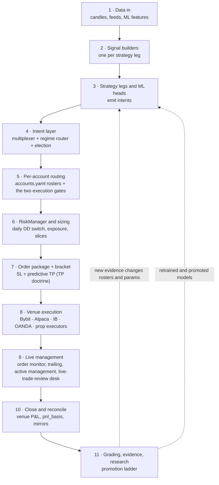

# Trading pipeline map — every step, technical and trading, side by side

> **Doc status:** `live` · category `lookup` · last verified `2026-11-14` · registered in [`docs/DOCUMENT-INDEX.md`](../../docs/DOCUMENT-INDEX.md)

**Gates this adds or changes:** none. This is a map, not a rule; it adds no CI guard, gate or required check.

**What this is.** One page that walks the live trading pipeline from market data to the research loop. Each stage
has two halves: **TECHNICAL** (which code runs it, where it lives, which service and VM run it, which broker) and
**TRADING** (which pieces make decisions there, how each works, its status and its track record). The operator asked
for it on 2026-11-14 so the system is easy to review; it is shown on the dashboard's **Work** tab
(`GET /api/bot/work/pipeline-map`).

**How to read it, and its limits.**

- **Code and config are the truth; this page is a claim about them** (RULE ONE: field beats comment). If the code
  disagrees with this page, the code wins: fix the skeleton. The drift checks at the end catch a path that moved.
- **This page is GENERATED.** The hand-written part is only this skeleton,
  `docs/reference/trading-pipeline-map.skeleton.md` (stage order, what each stage does, which modules run it).
  Every block marked "generated" is rebuilt from its source of truth by `src/runtime/pipeline_map.py`:
  `config/accounts.yaml`, `config/strategies.yaml`, `scripts/ops/strategy_status.py`,
  `comms/strategy_evidence/`, the journal's performance route, `ml/served/SERVED_MODELS.yaml`,
  `config/mandates.yaml`, `config/live_trade_review.yaml`, the `deploy/` unit files,
  `config/trader_import_closure.txt` and `scripts/ci/check_tp_doctrine.py`. The Work tab builds it live
  (`GET /api/bot/work/pipeline-map`); the committed `docs/reference/trading-pipeline-map.md` is a snapshot
  that `scripts/ops/pipeline_map_numbers.py` writes. Every number carries an "as of", a population and a
  provenance label (`src/runtime/provenance.py`); an unreadable source reads "—" with its read state, never 0.
- **The skeleton checks itself.** The "Drift checks" block at the end lists any module path the skeleton cites
  that no longer exists, any rostered leg with no definition, and any enabled leg on no book.
- **A live book never establishes edge.** Backtest evidence (offline, Stage 0) and live results are shown in
  separate columns. Live results check mechanics and cost only (OPERATING-PLAN § 2).
- **Upkeep.** The weekly doc-freshness check (`.claude/skills/doc-freshness/SKILL.md` § "Weekly core-doc
  currency") re-runs the generator and compares the skeleton with the week's merged work. When a merged change alters a
  stage below, update the skeleton in the same PR or a follow-up (a habit, not a gate).
- **Deeper sources.** [`docs/ARCHITECTURE-CANONICAL.md`](../ARCHITECTURE-CANONICAL.md) § "End-to-End Trade
  Pipeline", § "TP doctrine", § "Active management", § "Prop ticket flow";
  [`docs/plans/OPERATING-PLAN-2026-09-21.md`](../plans/OPERATING-PLAN-2026-09-21.md) § 2 (the ladder and statuses).
  The older [`docs/TRADE-PIPELINE.md`](../TRADE-PIPELINE.md) is unverified (status `unknown`) and is superseded by
  this page for orientation.

## Where things run

| Host | What runs there |
|---|---|
| **`ict-bot-arm`** (live VM) | `ict-trader-live.service` runs `python -m src.main` (the trader: data, signals, routing, risk, orders, order monitor, reconcile, live-review rows watcher). `ict-web-api.service` runs `uvicorn src.web.api.main:app` on :8001 (read paths for the dashboard). `caddy.service` serves HTTPS `ict-bot.duckdns.org` and proxies to :8001. `ict-git-sync` pulls `main` about every 5 minutes (`scripts/deploy_pull_restart.sh`). The prop executor (`ict-prop-executor.service`, `scripts/ops/prop_executor_tick.sh`), the fills pullers and the liveness watchdog run here too. |
| **`ict-trainer-vm`** | ML lifecycle: `ict-trainer.service` runs `scripts/ops/run_training_cycle.sh`; units under `deploy/trainer/` (candle refresh, forecast, lifecycle, promotion readiness, publish). Research and backtest workflows dispatched to it. |
| **`ict-ib-gateway`** | IB Gateway only, on the private subnet; the trader reaches it from the live VM. |
| **GitHub Actions** | Research harness runs, evidence records, live-review routines, system actions, diag relays. |
| **Brokers** | Bybit (crypto), Alpaca (US equities and ETFs), Interactive Brokers (futures and equity ETFs), OANDA (FX and metals, practice), prop firms through the prop executors. |
| **Dashboard** | `benbaichmankass/ict-trader-dashboard`, a Svelte SPA on GitHub Pages that calls the API browser-direct through Caddy (CORS is load-bearing). |

<!-- GEN:where -->

## The flow

## 1 · Data in

| TECHNICAL | TRADING |
|---|---|
| Connectors in `src/exchange/`: `bybit_connector.py`, `alpaca_connector.py`, `ib_connector.py`, `oanda_connector.py`. Helpers in `src/runtime/market_data.py` route each symbol to its source by `config/instruments.yaml`. Runs inside `ict-trader-live.service` on `ict-bot-arm`; IB bars come through `ict-ib-gateway`. Trainer-side candles: `deploy/trainer/ict-candle-refresh.service`. ML features for the entry heads: `src/runtime/ml_decision_features.py`, `src/runtime/ml_entry_eq_features.py`. Open interest: `src/runtime/oi_feed.py`. News: `src/news/news_pipeline.py`. | No decisions here, but data quality decides everything downstream. Rules that apply: off the trade path is not off the data path (a feature removed from trading keeps its data collection, `docs/reference/shadowed-features.yaml`); `accounts.yaml::symbols` is a data-pull list, never a gate. Track record: — (not a decision-maker). |

## 2 · Signal builders

| TECHNICAL | TRADING |
|---|---|
| `src/runtime/strategy_signal_builders.py` (one builder per strategy family, e.g. `turtle_soup_signal_builder`, `ict_scalp_signal_builder`). `src/runtime/pipeline.py::strategy_builders` maps legs to builders and `multiplexed_signal_builder` runs them each tick. Builders stamp regime, trend alignment and conviction inputs on the signal (`_stamp_regime`, `conviction_stamp`) and log shadow ML predictions (`_emit_shadow_preds`). Equity builders gate on `src/runtime/market_hours.py`. Runs in `ict-trader-live.service`. | A builder turns candles into a candidate setup for one leg: direction, entry, stop, target and the stamps the later stages read. A per-leg side filter can suppress one direction (`_resolve_side_filter`). Track record: per leg, in the generated table below. |

## 3 · Strategy legs and ML heads

| TECHNICAL | TRADING |
|---|---|
| Strategy modules in `src/units/strategies/`: `trend_donchian.py`, `htf_pullback_trend_2h.py`, `fvg_range_15m.py`, `turtle_soup.py`, `ict_scalp.py`, `squeeze_breakout_4h.py`, `fade_breakout_4h.py`, `e4_oi_shock_1h.py`, `hf_displacement_cont.py`, `hf_vwap_revert.py`, `vwap.py`, `macro_thesis/`, the ML legs `ml_entry.py`, `ml_entry_v2.py`, `ml_entry_eq.py`, the Claude desk `claude_desk.py`, and the pairs sleeve (`pairs_engine.py`, `pairs_executor.py`, its own gate `config/pairs.yaml`). Leg config and params: `config/strategies.yaml`. Served ML artifacts: `ml/served/` (the entry pointer is `ml/served/ENTRY_SERVED.json`, read by `src/runtime/ml_entry_served.py`; the model inventory and stages are `ml/served/SERVED_MODELS.yaml`). Models are trained on `ict-trainer-vm` (`ml/` package, `python -m ml ...`) and published to the repo. | **Rule legs**: trend (Donchian breakout), pullback in trend (2h/1d), fair-value-gap range, liquidity sweep reversal (turtle soup), ICT scalp, squeeze and fade breakouts, OI-shock, VWAP. Each trades the symbol its own evidence measured. **ML legs**: `ml_entry` (crypto entry classifier: a served model scores each candidate and trades above a threshold), `ml_entry_v2`, `ml_entry_eq` / `ml_entry_eq_struct` (equities). An ML leg trades the population its pooled test passed on. **Claude desk**: `claude_desk` (judgement-driven entries, paper). **Status** (testing / production / inactive) is derived from roster membership by `scripts/ops/strategy_status.py`, never declared. **Track record**: backtest and live per leg in the generated table; ML headline metrics with provenance in `ml/served/SERVED_MODELS.yaml`. |

<!-- GEN:ml -->

## 4 · Intent layer: multiplexer, regime router, election

| TECHNICAL | TRADING |
|---|---|
| `src/runtime/intent_multiplexer.py::_collect_intents` gathers each leg's intent and skips a leg on symbols outside its `symbols:`. `src/runtime/intents.py::gate_intents` applies the regime router once per tick (`src/runtime/regime/policy.py`, `detector.py`, `vol_detector.py`, `ml_vol_verdict.py`; cells in `config/regime_policy.yaml`). `src/runtime/arbitration_fanout.py::plan_per_account_election` then has every account elect from its own candidates via `intents.elect_from_gated`; `src/runtime/pipeline.py::_dispatch_rounds` routes each account its winner. Slice accounts: `src/runtime/allocator_ev.py::intent_allocation_score` (over `src/runtime/conviction.py::compute_conviction`; weights `config/slice_allocation.yaml`). Runs in `ict-trader-live.service`. | **Regime router**: drops intents in (regime, strategy, direction) cells marked `off`; only cells that lose money and generalize should exist (skill `regime-selectivity`). **Decider**: one net position per symbol per account; today a static-priority election (highest priority wins; same direction takes the max size). **Slices** (`position_model: slices`, e.g. `bybit_1`): several legs share a symbol, each with its own slice and bracket; the risk budget is split by allocation score. Track record: regime cells carry their own walk-forward evidence (`scripts/research/regime_cell_walkforward.py`); election history in `src/runtime/election_track_record.py`. |

## 5 · Per-account routing and the two execution gates

| TECHNICAL | TRADING |
|---|---|
| `src/core/coordinator.py::Coordinator.multi_account_execute` fans an elected signal to every account whose roster carries the leg, with a symbol-to-exchange guard. Rosters and account `mode:` are in `config/accounts.yaml`; leg `execution:` is in `config/strategies.yaml`; both fold into one `effective_dry`. Served on `/api/bot/config`. | **The only two gates**: account `mode: live \| dry_run` (written only by the operator-gated `set-account-mode` action) and leg `execution: live \| shadow` (shadow logs packages, sends nothing). There is no third gate. **The books**: Stage 1 demo floor (`bybit_1`, `alpaca_paper`, `ib_paper`): every testing leg trades there. Stage 2 real money plus its mirror (`bybit_2` + `bybit_portfolio`, `alpaca_live` + `alpaca_portfolio`). Prop accounts (`account_class: prop`) clear a superset bar. An account configures strategies, never symbols. |

<!-- GEN:accounts -->

## 6 · RiskManager and sizing

| TECHNICAL | TRADING |
|---|---|
| `src/units/accounts/risk.py::RiskManager.approve` (per trade) and `approve_amend` (for in-trade changes). Daily drawdown switch: `src/units/accounts/daily_dd_switch.py`, configured per account at `accounts.yaml::<acct>.risk.daily_dd_switch`. Prop rules: `src/units/accounts/prop_risk.py`, `src/prop/prop_risk_gate.py`, `src/prop/prop_sizing.py`. Counters: `src/runtime/risk_counters.py`. Slice admission: `src/runtime/positions.py::admit_slice`. Conviction and advisory sizing: `src/runtime/conviction_sizing.py`, `src/runtime/advisory_sizing.py`, news sizing `src/runtime/news_sizing.py`. Runs in `ict-trader-live.service`. | **Sizing**: per-account `risk_pct` of equity to the stop, capped by gross exposure (`GROSS_EXPOSURE_CAP`). **Daily DD switch**: the one sanctioned automatic off; when armed it blocks NEW entries after a day loss of 3% (non-prop) or 0.8 × the firm's daily limit (prop) and keeps open positions with their brackets; disarmed by default. <!-- population-ok: configured thresholds of the daily DD switch (accounts.yaml), not a measurement --> **No halting**: a refusal is per trade; the trader never flips its own mode. Track record: refusals are logged per trade (`runtime_logs/signal_audit.jsonl` on the live VM); — for P&L (not a P&L maker). |

## 7 · Order package and bracket (SL + predictive TP)

| TECHNICAL | TRADING |
|---|---|
| `src/runtime/orders.py::safe_place_order` validates size and prerequisites; `src/runtime/validation.py`. Bracket construction and calibration: `src/runtime/bracket_advisor.py`, `src/runtime/bracket_calibration.py`, `src/runtime/exit_plan.py`, `src/runtime/structure_levels.py`; TP venue cap `src/runtime/tp_venue_cap.py`; ML entry TP policy `src/runtime/ml_entry_tp_policy.py`. Packages land in `trade_journal.db` (order packages and trades). Compliance measurement: `scripts/ci/check_tp_doctrine.py`. | **TP doctrine**: every bracket carries a REAL predictive take-profit at entry, and the prediction is revised through the trade; a trailing exit does not exempt a leg (ARCHITECTURE-CANONICAL § "TP doctrine"). **Default exit**: a dynamic, structure-based SL and TP (§ "Active management"). Track record: compliance counts in the generated block (re-run the guard; never quote counts forward). |

## 8 · Venue execution

| TECHNICAL | TRADING |
|---|---|
| `src/units/accounts/execute.py::_submit_order` dispatches by exchange: Bybit (`pybit`, `src/runtime/bybit_ccxt.py`), Alpaca bracket orders (`src/units/accounts/alpaca_client.py`), IB native brackets (`src/units/accounts/ib_client.py`, via `ict-ib-gateway`), OANDA (`src/units/accounts/oanda_client.py`). Prop: `src/prop/prop_executor.py`, `src/prop/breakout_executor.py`, `src/prop/phone_executor.py`, driven by `ict-prop-executor.service`; one state machine per executor type (ARCHITECTURE-CANONICAL § "Prop ticket flow"). Accounts registry: `src/units/accounts/integrator.py`. | No discretion: an approved package is sent as built. Mechanics are what Stage 1 checks (1–2 clean trades). Track record: execution cost and slippage are measured after the fact (`src/runtime/execution_costs.py`, `src/runtime/trade_costs.py`); — here. |

## 9 · Live management

| TECHNICAL | TRADING |
|---|---|
| `src/runtime/order_monitor.py` (`run_monitor_tick`, `run_exit_evaluation_tick`) runs each strategy's monitor every tick inside `ict-trader-live.service`: partial closes, SL moves (`src/runtime/sl_mover.py`), trailing (`src/runtime/trail_vol.py`, `src/runtime/trail_decay.py`, `src/runtime/trail_cross.py`), TP revision (`src/runtime/tp_revision.py`), structure exits (`src/runtime/structure_exit_live.py`), regime-flip exits (`src/runtime/regime_flip_exit.py`), exit heads (`src/runtime/exit_head_apply.py`), protection re-assert (`src/runtime/protection_reassert.py`). Prop trails: `src/prop/prop_trail.py`. **Live-trade-review desk**: a reviewer (skill `.claude/skills/live-trade-review/SKILL.md`, priced by `scripts/research/live_review_outcomes.py`) writes one row per package to the `live-review/rows` branch and `comms/live_review/reviews.jsonl`; `src/runtime/live_review_rows_watch.py` (inside the trader) sees a new row and runs `scripts/ops/live_review_dispatch.py`, which hands over to `scripts/ops/live_review_apply.py`; each account decides through `RiskManager.approve_amend` and the venue is read back. Mandates: `config/mandates.yaml` (`MD-TRADE-DESK`). | **Strategy monitors** apply each leg's own exit rules (break-even, partials, trailing). **Active management**: any evidence-backed move of either bracket; each action class is advice-only until its own net-of-cost test passes (ARCHITECTURE-CANONICAL § "Active management"). **The desk**: decides the best trade action NOW for each open package (hold, close, partial, move TP, widen SL, resize), priced from the leg's own Stage-0 history; in-trade classes in `rows_lib.ADVICE_ONLY_ACTIONS` are logged, not sent. **Daily DD switch** (stage 6) blocks new entries only. Track record: desk rows and outcomes in `comms/live_review/reviews.jsonl`; exit-lever evidence per leg via skill `exit-refinement`; — as a single number. |

<!-- GEN:mandates -->

## 10 · Close and reconcile

| TECHNICAL | TRADING |
|---|---|
| `src/runtime/order_monitor.py::run_reconciliation_tick` (off-tick loop `src/runtime/reconcile_loop.py`) matches journal rows to the venue; `src/runtime/venue_pnl.py::match_venue_record` takes the venue's realized P&L and flags gaps; `pnl_basis` records which source a trade's P&L came from. Venue fills: `src/runtime/exchange_fills_puller.py`, `src/runtime/exchange_fills_alpaca.py`, `src/runtime/exchange_fills_ib.py`, run by `ict-exchange-fills-pull` (`scripts/ops/pull_bybit_transaction_log.py`), `ict-alpaca-fills-pull`, `ict-ib-executions-pull`; funding `ict-exchange-funding-pull`. Broker truth: `src/runtime/broker_truth.py`. Closed-flat check: `src/runtime/closed_flat_invariant.py`. Prop: `src/prop/prop_reconcile.py`. Store: `trade_journal.db` (`src/units/db/database.py`). Read on `/api/bot/performance`, `/api/bot/pnl*`. | **Venue P&L is the truth** for a closed trade; computed P&L is a fallback, labelled by provenance (`MEASURED` / `ESTIMATED` / `FABRICATED` / `UNVERIFIED`, never folded together). **Mirrors**: the real-money mirror (`bybit_portfolio`, `alpaca_portfolio`) takes the same legs as live; its net-of-cost window is the demotion signal. Track record: the journal trust state (divergent or unrecorded accounts) is printed in the generated block. |

## 11 · Grading, evidence and the research loop

| TECHNICAL | TRADING |
|---|---|
| Evidence records: `comms/strategy_evidence/<leg>.json` (Stage-0 backtest, net of the full cost stack, rule registered before the run). Research questions: `research/queue/` (skill `research-ops`). Grading: `comms/claude_strategy_scores.jsonl` (skill `performance-review`), follow-ups through skill `perf-followup`. Trainer lifecycle and promotion readiness: `deploy/trainer/ict-trainer-lifecycle.service`, `deploy/trainer/ict-promotion-readiness.service`. Status: `scripts/ops/strategy_status.py`. Builds: `docs/claude/work/checklist/`; follow-through: `docs/claude/work/pipeline/` (one record per file, via `scripts/ops/pipeline.py`). | **Promotion ladder** (OPERATING-PLAN § 2): Stage 0 backtest (edge decided offline, net of full cost) → real money; a demoted leg goes back to the demo floor and keeps trading there for data while it is iterated; retirement only by record (`enabled: false`). Prop legs clear a superset. A live or paper book never establishes edge. Track record: the generated table below. |

## Per-leg status and track record (generated)

<!-- GEN:legs -->

## Drift checks (generated)

<!-- GEN:checks -->
